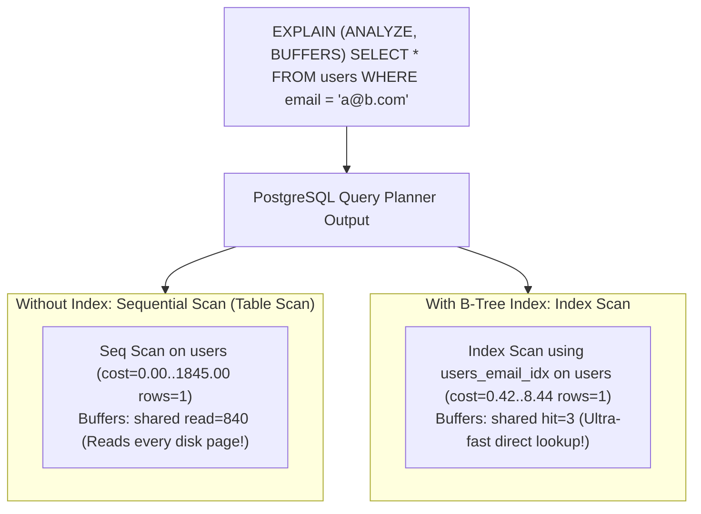

# EXPLAIN

## Learning objective

Read and interpret SQLite `EXPLAIN QUERY PLAN` output, distinguish sequential scans from index scans, understand cost estimation, and use query plans to optimize slow queries.

## Why this matters

You cannot fix what you cannot measure. When a query slows down as the database grows, guessing which index to add is wasteful. `EXPLAIN QUERY PLAN` tells you exactly how the database executes your query — which tables are scanned, which indexes are used, and how rows are filtered. Professional engineers read query plans before optimizing.

## Mental model

A query plan is the database's step-by-step recipe for answering your query. Each step is an operation like "scan this table" or "look up this index." Steps are nested: an inner step feeds rows to an outer step.

```
Query: SELECT * FROM users WHERE email = 'alice@example.com'

Plan (no index):
  SCAN users                                      ← reads every row

Plan (with index on email):
  SEARCH users USING INDEX idx_email (email=?)    ← jumps directly
```

The plan is a tree. Leaf nodes read data. Inner nodes combine or filter. Reading the plan bottom-up or indentation-first reveals the execution order.

## Visual model



## Core idea

In SQLite, `EXPLAIN QUERY PLAN` returns four columns:

| Column | Meaning |
|---|---|
| `id` | Node ID (indentation shows parent-child) |
| `parent` | Parent node ID |
| `notused` | Unused; reserved for future use — scan over it |
| `detail` | Description of the operation |

Key operations:
- `SCAN TABLE <name>` — full table scan (no index, slow for large tables)
- `SEARCH TABLE <name> USING INDEX <idx>` — index lookup (fast)
- `SEARCH TABLE <name> USING INTEGER PRIMARY KEY` — rowid lookup (fastest)
- `USE TEMP B-TREE FOR ORDER BY` — sorting required (can be slow)
- `USE TEMP B-TREE FOR GROUP BY` — grouping required

## Under the hood

When you run a query, SQLite's query planner:
1. Parses the SQL into a syntax tree.
2. Generates multiple possible execution plans.
3. Estimates the cost of each plan using table statistics (row count, index selectivity).
4. Chooses the lowest-cost plan.

The cost estimation uses:
- The `sqlite_stat1` table (populated by `ANALYZE`), which records table row counts and index cardinality. (`sqlite_stat4` adds histogram-like column samples, but only in builds compiled with `SQLITE_ENABLE_STAT4`.)
- Heuristics: index lookup costs ~O(log n), full scan costs ~O(n).
- SQLite's planner works in logarithmic cost units — it compares the log of rows/pages a plan touches, not raw byte costs.

`EXPLAIN QUERY PLAN` shows only the chosen plan's shape in the `detail` column — no cost numbers. (Costs appear in PostgreSQL's `EXPLAIN` output, not SQLite's.)

## How Go uses it

- **Query optimization**: Run `EXPLAIN QUERY PLAN` via Go, print the plan, and analyze.
- **Benchmarking**: Compare plans before and after adding indexes.
- **Code review**: Include query plans in PR descriptions for schema changes.
- **Automated testing**: Assert that certain queries use index scans (not full scans).

## Go example

```go
package main

import (
	"database/sql"
	"fmt"
	"log"

	_ "modernc.org/sqlite"
)

func main() {
	db, err := sql.Open("sqlite", ":memory:")
	if err != nil {
		log.Fatal(err)
	}
	defer db.Close()

	_, err = db.Exec(`
		CREATE TABLE users (
			id INTEGER PRIMARY KEY,
			name TEXT NOT NULL,
			email TEXT NOT NULL
		);
		INSERT INTO users VALUES (1, 'Alice', 'alice@example.com');
		INSERT INTO users VALUES (2, 'Bob', 'bob@example.com');
		INSERT INTO users VALUES (3, 'Carol', 'carol@example.com');
	`)
	if err != nil {
		log.Fatal(err)
	}

	queries := []string{
		"SELECT * FROM users WHERE id = 1",
		"SELECT * FROM users WHERE email = 'alice@example.com'",
		"SELECT * FROM users ORDER BY name",
	}

	fmt.Println("=== Without Indexes ===")
	for _, q := range queries {
		fmt.Printf("\nQuery: %s\n", q)
		printPlan(db, q)
	}

	db.Exec("CREATE INDEX idx_users_email ON users(email)")
	db.Exec("CREATE INDEX idx_users_name ON users(name)")

	fmt.Println("\n=== With Indexes ===")
	for _, q := range queries {
		fmt.Printf("\nQuery: %s\n", q)
		printPlan(db, q)
	}
}

func printPlan(db *sql.DB, query string) {
	rows, err := db.Query("EXPLAIN QUERY PLAN " + query)
	if err != nil {
		log.Fatal(err)
	}
	defer rows.Close()
	for rows.Next() {
		var id, parent, notused int
		var detail string
		if err := rows.Scan(&id, &parent, &notused, &detail); err != nil {
			log.Fatal(err)
		}
		fmt.Printf("  id=%d parent=%d %s\n", id, parent, detail)
	}
}
```

Output (actual, captured from `go run`):

Without indexes:
```
Query: SELECT * FROM users WHERE id = 1
  id=2 parent=0 SEARCH users USING INTEGER PRIMARY KEY (rowid=?)

Query: SELECT * FROM users WHERE email = 'alice@example.com'
  id=2 parent=0 SCAN users

Query: SELECT * FROM users ORDER BY name
  id=3 parent=0 SCAN users
  id=11 parent=0 USE TEMP B-TREE FOR ORDER BY
```

With indexes:
```
Query: SELECT * FROM users WHERE email = 'alice@example.com'
  id=3 parent=0 SEARCH users USING INDEX idx_users_email (email=?)

Query: SELECT * FROM users ORDER BY name
  id=4 parent=0 SCAN users USING INDEX idx_users_name
```

Note that the `id` values are small integers (2, 3, 4...) chosen by the planner, not a stable contract — match plans by their `detail` text, not by node IDs.

## Step-by-step execution

For `EXPLAIN QUERY PLAN SELECT * FROM users WHERE email = 'alice@example.com'`:

1. SQLite's planner receives the query.
2. It considers two strategies:
   - Full scan: read every row, check the WHERE clause.
   - Index lookup (if `idx_users_email` exists): search index for 'alice@example.com', get rowid, read row.
3. Planner estimates costs. For 3 rows, full scan is cheap. For 1M rows, index is far cheaper.
4. The chosen plan is returned as result rows.
5. Without index: `SCAN users`.
6. With index: `SEARCH users USING INDEX idx_users_email`.

## Common mistakes

- Ignoring `EXPLAIN QUERY PLAN` output: Adding an index doesn't guarantee it will be used. Always verify.
- Misreading indentation: Parent-child relationships in the plan show nesting. A SUBQUERY inside a SCAN is different from a SCAN inside a SUBQUERY.
- Not running `ANALYZE`: Without table statistics, the planner may choose a bad plan. Run `ANALYZE` periodically.
- Testing plans on empty tables: The planner may choose a full scan for a table with 0 rows. Always test with representative data volumes.
- Confusing `EXPLAIN` (bytecode) with `EXPLAIN QUERY PLAN` (logical plan): Use `EXPLAIN QUERY PLAN` for optimization; `EXPLAIN` shows VDBE instructions.

## Debugging walkthrough

**Scenario**: An `IN` query is slow even with an index.

```sql
SELECT * FROM users WHERE id IN (1, 2, 3, ..., 1000);
```

**Plan**: verified against this module's driver (SQLite 3.53), even a 10-element `IN` list on the rowid produces `SEARCH users USING INTEGER PRIMARY KEY (rowid=?)` — SQLite loops the index lookup once per list element rather than falling back to a scan. So if an `IN` query on an indexed column is slow, the index is not being used at all (wrong column, type mismatch, or a function wrapping the column) — check the plan, don't assume the list size forced a scan.

**Fix**: For very large lists, a temporary table with a JOIN keeps the SQL bind-parameter count low (SQLite caps bound parameters — 32766 in modern versions):

```sql
CREATE TEMP TABLE ids (id INTEGER PRIMARY KEY);
INSERT INTO ids VALUES (1), (2), ..., (1000);
SELECT * FROM users JOIN ids ON users.id = ids.id;
```

**Plan**: `SEARCH users USING INTEGER PRIMARY KEY` for each id in the temp table.

## Production notes

- **PostgreSQL `EXPLAIN ANALYZE`**: Unlike SQLite, PostgreSQL can execute the query and show actual vs. estimated rows and times. `EXPLAIN ANALYZE` is the gold standard.
- **SQLite limitations**: SQLite's planner is simpler than PostgreSQL's. It doesn't support parallel query plans, bitmap scans, or hash joins.
- **Plan visualization**: Tools like `pgAdmin` (PostgreSQL) and `sqlite3` CLI with `.eqp` show formatted plans.
- **Monitoring**: Log slow queries and their plans for analysis. Use `EXPLAIN QUERY PLAN` to investigate.

## Performance implications

- A query plan reveals which access paths the planner chose. If a plan's cost grows linearly with table size, you need an index.
- Some operations are inherently expensive: `ORDER BY` without an index requires sorting all rows (O(n log n) memory). Add an index on the sort column.
- Subqueries in `WHERE` or `FROM` may be executed per row (correlated subquery). Check the plan for `SCAN` nested inside loops.
- The planner's choices are only as good as the statistics. Run `ANALYZE` after significant data changes.

## Practice task

1. Create a table `orders` with `id`, `user_id`, `total`, `created_at`.
2. Insert 1,000 rows with varied `user_id` values (1-100).
3. Write 5 different queries (WHERE, JOIN, ORDER BY, GROUP BY, subquery).
4. Run `EXPLAIN QUERY PLAN` for each, with and without appropriate indexes.
5. Print and compare the plans.

## Tests / verification

```bash
go run ./curriculum/modules/09-sql-postgres-persistence/lessons/22-explain
go test ./curriculum/modules/09-sql-postgres-persistence/lessons/22-explain
```

## Review questions

1. What is the difference between `SCAN` and `SEARCH` in a query plan?
2. Why might the planner choose a full table scan even when an index exists?
3. What does `USE TEMP B-TREE FOR ORDER BY` mean?
4. How does `ANALYZE` improve query planning?
5. What is the difference between `EXPLAIN` and `EXPLAIN QUERY PLAN` in SQLite?

## NEXT UP

[Query Timeouts With Context](../23-query-timeouts-with-context/README.md)
