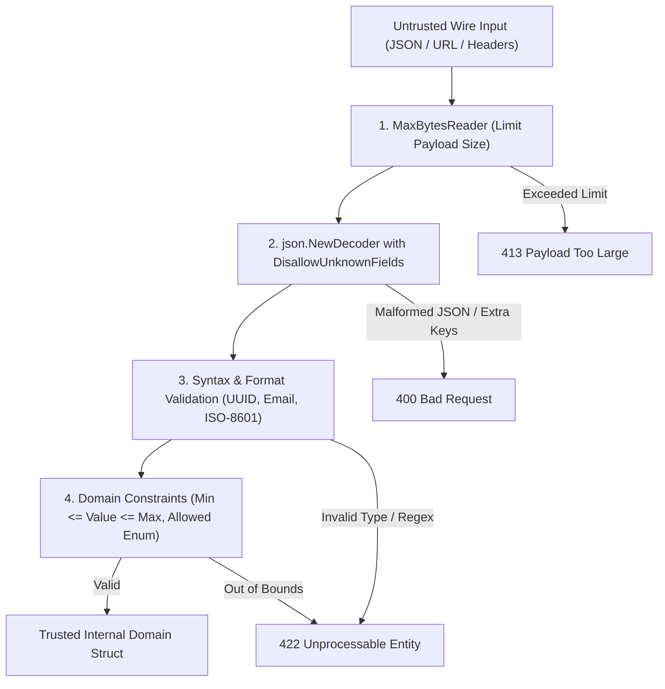

# Input validation for security

## Learning objective

Implement security-focused input validation in Go using allowlists, denylists, and sanitization, and distinguish between validation for correctness and validation for security.

## Why this matters

Input validation is the most effective defense against injection attacks (SQL, NoSQL, OS command, LDAP), path traversal, and XSS. Multiple OWASP Top 10 categories - injection, cross-site scripting, and the validation gaps behind broken access control - trace back to missing or insufficient input validation. Security-focused validation is different from form validation: it enforces what is allowed rather than what is familiar. An email field that rejects `' OR 1=1;--` is not being pedantic — it is preventing SQL injection.

## Mental model

Imagine an airport security checkpoint. Every passenger passes through gates: identity check (type validation), baggage scan (format validation), body scan (length validation), and interview (business rule validation). Each gate either passes the passenger through or diverts them to security. The gates are arranged in order of cost: cheap checks first (type, length), expensive checks last (business rules). An allowlist is the VIP list: only pre-approved items enter. A denylist is the no-fly list: known bad items are blocked but everything else passes.

## Visual model



## Core idea

Security input validation has two contrasting strategies:

- **Allowlist (positive validation)**: define exactly what is permitted and reject everything else. Example: `^[a-zA-Z0-9]+$` for usernames. Stronger security because you must know all valid patterns.
- **Denylist (negative validation)**: define known bad patterns and reject them. Example: block `DROP TABLE`, `<script>`. Weaker security because attackers invent new bypasses faster than denylists update.

Validation at the boundary means you validate input as soon as it enters your system, at the trust boundary between the external world and your application. This is the principle of "never trust, always verify" applied at the earliest point.

Three layers of validation:

| Layer | What it checks | Example |
|---|---|---|
| Type | Is the data the right kind? | String, int, email |
| Format | Does it match the pattern? | Regex, UUID, date |
| Semantics | Does it make business sense? | Amount > 0, future date |

Security validation focuses on type and format. Business validation handles semantics.

## Under the hood

Go's `encoding/json` performs type validation during unmarshalling: it rejects type mismatches (a string where an int is expected). Invalid UTF-8 in string values is replaced with U+FFFD rather than rejected, so byte-level hygiene must not rely on the decoder. Neither does it enforce string length, character classes, unknown-field rejection (`DisallowUnknownFields`), or semantic rules.

The `go-playground/validator` package uses struct tags for declarative validation:

```go
type Input struct {
	Name  string `validate:"required,min=3,max=100,alphanum"`
	Email string `validate:"required,email"`
	Age   int    `validate:"gte=0,lte=150"`
}
```

Under the hood, `validator` uses reflection to iterate struct fields, parse tag rules, and apply them. Each rule is a function registered with the validator engine. Custom validators can be added for domain-specific checks.

For security validation, always apply the allowlist approach at the boundary: accept only known-good patterns. Reject everything else.

## How Go uses it

Go's standard library provides several tools for security input validation:

- **`regexp`**: compile allowlist patterns once with `regexp.MustCompile` and reuse them.
- **`net/mail.ParseAddress`**: validates email format according to RFC 5322.
- **`net/url.Parse`**: validates and parses URLs, rejecting malformed ones.
- **`strconv`**: `strconv.Atoi`, `strconv.ParseFloat` for numeric validation.
- **`strings`**: `strings.Contains`, `strings.HasPrefix` for denylist checks (use as fallback only).
- **`database/sql`** parameterized queries: the ultimate input validation for SQL — user input never becomes SQL syntax.

Third-party packages like `go-playground/validator`, `ozzo-validation`, and `golang.org/x/text` extend this for complex rules.

## Go example

```go
package main

import (
	"encoding/json"
	"errors"
	"fmt"
	"log"
	"net/http"
	"net/mail"
	"regexp"
	"strings"
)

var (
	usernameRE = regexp.MustCompile(`^[a-zA-Z0-9_]{3,30}$`)
	docIDRE    = regexp.MustCompile(`^[a-zA-Z0-9_-]{1,64}$`)
)

type CreateUserRequest struct {
	Username     string `json:"username"`
	Email        string `json:"email"`
	Password     string `json:"password,omitempty"`
	ReferralCode string `json:"referral_code,omitempty"`
}

type ValidationError struct {
	Field   string `json:"field"`
	Message string `json:"message"`
}

func (v ValidationError) Error() string {
	return fmt.Sprintf("%s: %s", v.Field, v.Message)
}

func validateCreateUser(req CreateUserRequest) []ValidationError {
	var errs []ValidationError

	if !usernameRE.MatchString(req.Username) {
		errs = append(errs, ValidationError{
			Field: "username", Message: "must be 3-30 alphanumeric characters or underscores",
		})
	}

	if _, err := mailParseAddress(req.Email); err != nil {
		errs = append(errs, ValidationError{
			Field: "email", Message: "must be a valid email address",
		})
	}

	if len(req.Password) < 8 || len(req.Password) > 128 {
		errs = append(errs, ValidationError{
			Field: "password", Message: "must be between 8 and 128 characters",
		})
	}

	if req.ReferralCode != "" && !docIDRE.MatchString(req.ReferralCode) {
		errs = append(errs, ValidationError{
			Field: "referral_code", Message: "contains invalid characters",
		})
	}

	return errs
}

func mailParseAddress(addr string) (struct{}, error) {
	// RFC 5322 validation via the standard library (see prose).
	_, err := mail.ParseAddress(addr)
	return struct{}{}, err
}

func ValidateAPIKey(key string) error {
	if len(key) == 0 {
		return errors.New("key must not be empty")
	}
	if len(key) < 32 {
		return fmt.Errorf("key too short: %d < 32", len(key))
	}
	if len(key) > 128 {
		return fmt.Errorf("key too long: %d > 128", len(key))
	}
	for _, c := range key {
		if !((c >= 'a' && c <= 'z') || (c >= 'A' && c <= 'Z') || (c >= '0' && c <= '9') || c == '-' || c == '_') {
			return fmt.Errorf("invalid character: %c", c)
		}
	}
	compromised := map[string]bool{
		"compromised-key-1234567890abcdef1234567890": true,
	}
	if compromised[key] {
		return errors.New("key has been compromised")
	}
	return nil
}

func validateName(name string) error {
	if strings.TrimSpace(name) == "" {
		return errors.New("name must not be empty")
	}
	if !usernameRE.MatchString(name) {
		return errors.New("name contains invalid characters")
	}
	return nil
}

func main() {
	http.HandleFunc("/users", func(w http.ResponseWriter, r *http.Request) {
		if r.Method != http.MethodPost {
			http.Error(w, "method not allowed", http.StatusMethodNotAllowed)
			return
		}
		var req CreateUserRequest
		dec := json.NewDecoder(r.Body)
		dec.DisallowUnknownFields()
		if err := dec.Decode(&req); err != nil {
			http.Error(w, fmt.Sprintf(`{"error":"invalid JSON: %s"}`, err.Error()), http.StatusBadRequest)
			return
		}
		if errs := validateCreateUser(req); len(errs) > 0 {
			w.Header().Set("Content-Type", "application/json")
			w.WriteHeader(http.StatusUnprocessableEntity)
			json.NewEncoder(w).Encode(map[string]interface{}{"errors": errs})
			return
		}
		w.Header().Set("Content-Type", "application/json")
		w.WriteHeader(http.StatusCreated)
		json.NewEncoder(w).Encode(map[string]string{"status": "created", "username": req.Username})
	})

	fmt.Println("Input validation server on :8080")
	log.Fatal(http.ListenAndServe(":8080", nil))
}
```

## Step-by-step execution

For a POST request to `/users` with body `{"username":"alice","email":"alice@test.com","password":"secret123"}`:

1. The decoder parses the body with `DisallowUnknownFields`. If the JSON is malformed or carries unknown fields, return 400. Trust boundary crossed: raw bytes -> Go struct.
2. `validateCreateUser` runs four validation gates sequentially (the JSON type gate ran inside the decoder, which also rejects unknown fields via `DisallowUnknownFields`).
3. Gate 1 (type): handled by JSON decoder — `username` is a string, not a number.
4. Gate 2 (format): `usernameRE.MatchString("alice")` returns true. Pass.
5. Gate 3 (format): `mail.ParseAddress("alice@test.com")` returns no error. Pass.
6. Gate 4 (length): `len("secret123")` = 9, between 8 and 128. Pass.
7. Gate 5 (referral): empty string, skipped.
8. All gates pass. Handler creates the user and returns 201.

For a body with `{"username":"<script>","email":"bad","password":"short"}`:

1. JSON parses OK.
2. Gate 2: `usernameRE` rejects `<script>` — only alphanumeric allowed.
3. Gate 3: `mail.ParseAddress("bad")` returns error.
4. Gate 4: `len("short")` = 5, less than 8.
5. Three validation errors returned with field-level messages.

## Common mistakes

- Validating input format but not semantics — checking email has `@` but not that the domain exists or that the local part is properly quoted.
- Validating input on the client side only — client validation is for UX, server validation is for security. Never trust the client.
- Rejecting input that is "too long" but accepting any length below the maximum without considering memory impact — a 10MB string within a 10MB limit still exhausts memory.
- Using denylist as the primary strategy — attackers invent new encodings faster than you add patterns to the list.
- Validating after processing — input must be validated immediately at the boundary, not after partial parsing or decoding.

## Debugging walkthrough

Consider this handler that validates input after partial processing:

```go
func createDocHandler(w http.ResponseWriter, r *http.Request) {
	var doc struct {
		Title    string `json:"title"`
		Content  string `json:"content"`
		AuthorID string `json:"author_id"`
	}
	json.NewDecoder(r.Body).Decode(&doc)
	// Validation happens AFTER decoding and AFTER storing in DB.
	rows, _ := db.Query("INSERT INTO docs (title, content, author_id) VALUES ($1, $2, $3)",
		doc.Title, doc.Content, doc.AuthorID)
	if strings.Contains(doc.Title, "DROP") {
		log.Println("Suspicious title:", doc.Title)
	}
}
```

**Symptom**: The INSERT runs before validation completes. If validation fails, the bad data is already in the database.

**Investigation**: The trust boundary is crossed twice: once when JSON is decoded (untrusted -> struct), and once when the INSERT executes (struct -> database). Validation should occur between these two boundaries, not after the second.

**Root cause**: Validation is an afterthought, placed after the damage is done. The handler does not return early on validation failure.

**Fix**: Validate immediately after JSON decoding and before any database operation:

```go
func createDocHandler(w http.ResponseWriter, r *http.Request) {
	var doc Doc
	json.NewDecoder(r.Body).Decode(&doc)
	if errs := validateDoc(doc); len(errs) > 0 {
		json.NewEncoder(w).Encode(map[string]interface{}{"errors": errs})
		return
	}
	// Only now is data safe to store.
	db.Query("INSERT INTO docs ...", doc.Title, doc.Content, doc.AuthorID)
}
```

## Production notes

- Enforce input validation at the API gateway or ingress controller level when possible. This removes the burden from individual services.
- Use `go-playground/validator` for struct tag validation. Register custom validators for domain-specific rules.
- Never return internal details in validation error messages. "Invalid input" is better than "password must contain exactly one uppercase letter, one number, and be between 8-12 characters".
- Validate all input, including headers, query parameters, and URL path segments — not just request bodies.
- Log validation failures at WARN level for monitoring. A spike in validation errors may indicate an attack probe.

## Performance implications

- Regex compilation once at init: negligible cost. Avoid compiling regex in request paths.
- `mail.ParseAddress` allocates on every call. For high-throughput endpoints, pre-validate format with a simpler regex and do full RFC validation asynchronously.
- Length checks are O(n) on input size. For large inputs (file uploads), stream the data and validate chunks.
- JSON decoding is the most expensive part of input validation. For large payloads, use `json.Decoder` with `UseNumber` and validate incrementally.

## Practice task

Write a Go function `ValidateAPIKey(key string) error` that:
- Rejects keys shorter than 32 characters or longer than 128 characters.
- Rejects keys containing characters other than `[a-zA-Z0-9_-]`.
- Rejects keys that have been compromised (use a simulated compromised-key list).
- Returns a descriptive error for each failure.
- Then write a `main()` that tests five keys (valid, too short, invalid character, compromised, and empty) and prints results.

## Tests / verification

```bash
go run ./curriculum/modules/10-auth-security/lessons/03-input-validation-for-security
go test ./curriculum/modules/10-auth-security/lessons/03-input-validation-for-security
```

The test file `main_test.go` contains table-driven tests that verify:
- `ValidateAPIKey` returns nil for a valid 40-character key.
- `ValidateAPIKey` returns an error for keys shorter than 32 characters.
- `ValidateAPIKey` returns an error for keys with special characters.
- `ValidateAPIKey` returns a specific error for compromised keys.

## Review questions

1. Why is an allowlist (positive validation) more secure than a denylist (negative validation)?
2. In a Go HTTP handler, where should the input validation boundary be placed relative to JSON decoding and database access?
3. What OWASP Top 10 categories does input validation help prevent? Name at least three.
4. Why is email validation using a simple `@` check insufficient for security purposes?
5. How would you validate that a file upload is a PNG image without relying on the file extension?

## NEXT UP

[Authentication Vs Authorization](../04-authentication-vs-authorization/README.md)
