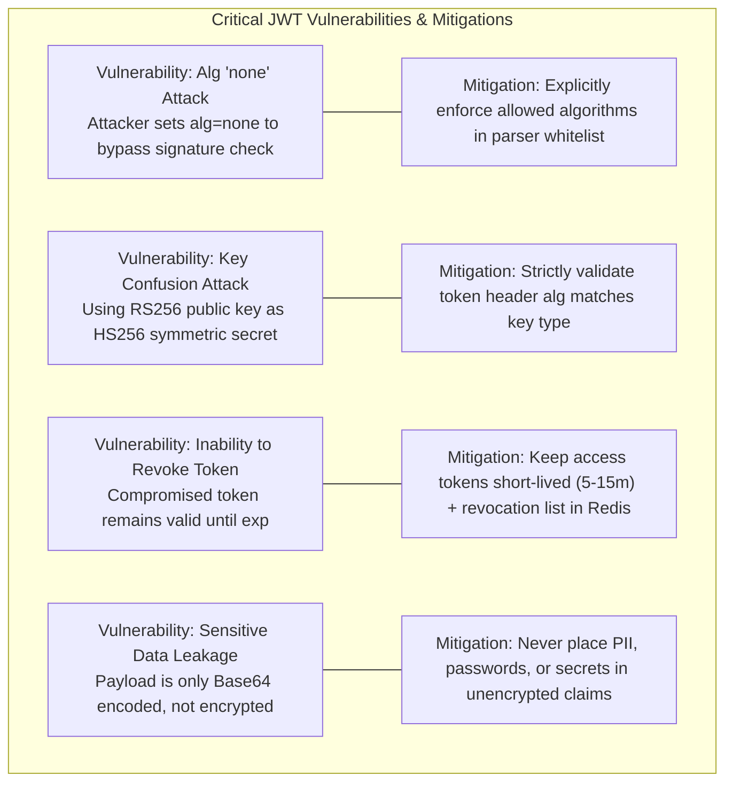

# JWT risks

## Learning objective

Identify and mitigate common JWT vulnerabilities in Go services including the `alg=none` attack, key confusion, token theft, replay attacks, and the inherent difficulty of token revocation.

## Why this matters

JWTs are widely adopted but frequently misimplemented. The "none algorithm" vulnerability swept through several major JWT libraries in 2015 (Tim McLean's research), and key confusion attacks (forcing an RS256 public key to verify an HS256 token) have compromised real-world auth systems. Token theft via XSS or network interception is the most common attack on JWT-based systems because the stateless design makes revocation near-impossible without a denylist. Understanding these risks is essential before deploying JWTs in production — the convenience of stateless tokens comes with a distinct security tradeoff.

## Mental model

A JWT is a signed document. The signature proves the document has not been tampered with since signing. But the document itself is readable by anyone who possesses it. If an attacker steals the document, they can present it as their own until it expires. The issuer cannot "un-sign" a document — they can only publish a list of cancelled document IDs (denylist), which requires a database lookup, defeating the purpose of stateless tokens.

## Visual model



## Core idea

The major JWT risks fall into five categories:

| Risk | Description | Impact |
|---|---|---|
| Algorithm confusion | Attacker changes `alg` from `RS256` to `HS256` and signs with the public key | Token forgery |
| `alg: none` | Attacker sets `alg` to `none` and removes the signature | Complete authentication bypass |
| Token theft | Session hijacking via XSS, network interception, or device theft | Account takeover |
| Replay attacks | Same token used multiple times in different contexts | Unauthorized actions |
| Revocation difficulty | No built-in way to invalidate a token before expiry | Stolen tokens remain usable |
| Weak signing key | Poor entropy or leaked private key | All tokens can be forged |

## Under the hood

**Algorithm confusion attack**: The JWT header contains the algorithm. If the server's verification code accepts the algorithm from the header and selects the verification key based on it, an attacker can:

1. Obtain the server's public RSA key (often exposed via JWKS endpoint).
2. Create a JWT with `alg: HS256` (HMAC).
3. Sign the header+payload using the public key as the HMAC secret.
4. The server, seeing `HS256` in the header, uses the "secret" to verify — in many implementations, this is the same public key the server loaded for RSA verification.

Mitigation: always validate that the algorithm matches the expected one before verifying.

**`alg: none` attack**: The `none` algorithm means "no signature." Vulnerable libraries accept tokens without signatures when the algorithm is `none`. `golang-jwt/jwt` v5 explicitly rejects `none` by default, but older versions (v3 and earlier) were vulnerable.

**Token theft**: Since JWTs are sent with every request (typically as a Bearer header), any XSS vulnerability or insecure channel can leak the token. JWTs sent as `Authorization` headers or kept in `localStorage` are readable by JavaScript, so any XSS can exfiltrate them. Storing the JWT in an `HttpOnly` cookie regains that protection at the cost of CSRF exposure (see lesson 16).

## How Go uses it

`golang-jwt/jwt` v5 includes built-in protections against many of these attacks:

- **`alg: none`**: v5 rejects unsigned tokens by default — accepting them requires explicitly signing with `jwt.UnsafeAllowNoneSignatureType`. `jwt.WithValidMethods([]string{"RS256"})` additionally whitelists the algorithms you expect.
- **Algorithm validation**: the key function (`KeyFunc`) receives the parsed token and can inspect `token.Method` to verify the algorithm.
- **`jwt.ParseWithClaims`**: must be used instead of `jwt.Parse` to ensure claims are type-safe.

The Go security team recommends:

1. Always use `jwt.ParseWithClaims` with a concrete claims struct.
2. Validate `token.Method` against a whitelist in the key function.
3. Never pass `nil` as the key function — v5 returns an "unverifiable" error rather than accepting the token, but a `nil` keyfunc is always a bug worth a compile-time-visible guard.
4. Use asymmetric algorithms (RS256/ES256) for multi-service architectures.

## Go example

```go
package main

import (
	"crypto/hmac"
	"crypto/rand"
	"crypto/rsa"
	"crypto/sha256"
	"encoding/base64"
	"encoding/json"
	"errors"
	"fmt"
	"log"
	"strings"
	"sync"
	"time"

	"github.com/golang-jwt/jwt/v5"
)

var (
	rsaPrivateKey *rsa.PrivateKey
	rsaPublicKey  *rsa.PublicKey
)

func init() {
	var err error
	rsaPrivateKey, err = rsa.GenerateKey(rand.Reader, 2048)
	if err != nil {
		log.Fatalf("key generation: %v", err)
	}
	rsaPublicKey = &rsaPrivateKey.PublicKey
}

type DenyList struct {
	mu sync.RWMutex
	m  map[string]time.Time
}

func NewDenyList() *DenyList {
	return &DenyList{m: make(map[string]time.Time)}
}

func (dl *DenyList) Revoke(jti string, expiry time.Time) {
	dl.mu.Lock()
	dl.m[jti] = expiry
	dl.mu.Unlock()
}

func (dl *DenyList) IsRevoked(jti string) bool {
	dl.mu.RLock()
	exp, ok := dl.m[jti]
	dl.mu.RUnlock()
	if !ok {
		return false
	}
	if time.Now().After(exp) {
		dl.mu.Lock()
		delete(dl.m, jti)
		dl.mu.Unlock()
		return false
	}
	return true
}

type SafeClaims struct {
	jwt.RegisteredClaims
	Role  string `json:"role"`
	Scope string `json:"scope"`
}

func IssueToken(userID, role string) (string, error) {
	now := time.Now()
	claims := SafeClaims{
		RegisteredClaims: jwt.RegisteredClaims{
			Subject:   userID,
			ExpiresAt: jwt.NewNumericDate(now.Add(15 * time.Minute)),
			IssuedAt:  jwt.NewNumericDate(now),
			ID:        fmt.Sprintf("%s-%d", userID, now.UnixNano()),
		},
		Role:  role,
		Scope: "api:read",
	}
	token := jwt.NewWithClaims(jwt.SigningMethodRS256, claims)
	return token.SignedString(rsaPrivateKey)
}

func VerifyTokenSafe(tokenStr string, denyList *DenyList) (*SafeClaims, error) {
	token, err := jwt.ParseWithClaims(tokenStr, &SafeClaims{}, func(token *jwt.Token) (interface{}, error) {
		if token.Method != jwt.SigningMethodRS256 {
			return nil, fmt.Errorf("unexpected signing method: %v", token.Header["alg"])
		}
		return rsaPublicKey, nil
	})
	if err != nil {
		return nil, fmt.Errorf("parse failed: %w", err)
	}
	claims, ok := token.Claims.(*SafeClaims)
	if !ok || !token.Valid {
		return nil, errors.New("invalid token")
	}
	if denyList.IsRevoked(claims.ID) {
		return nil, errors.New("token revoked")
	}
	return claims, nil
}

// VerifyTokenVulnerable is a hand-rolled verifier that reproduces the two
// historical flaws this lesson teaches. golang-jwt/jwt v5 blocks both (a nil
// keyfunc errors out, and HS256 verification rejects non-byte keys), so the
// vulnerable behavior is implemented manually for demonstration:
//
//  1. Algorithm confusion: the attacker-controlled alg header selects the
//     verification key, so an HS256 token "signed" with the RSA public-key
//     bytes is accepted.
//  2. alg: none: tokens with no algorithm are accepted without any
//     signature check.
func VerifyTokenVulnerable(tokenStr string) (string, error) {
	parts := strings.Split(tokenStr, ".")
	if len(parts) != 3 {
		return "", errors.New("malformed token")
	}
	headerBytes, err := base64.RawURLEncoding.DecodeString(parts[0])
	if err != nil {
		return "", err
	}
	payloadBytes, err := base64.RawURLEncoding.DecodeString(parts[1])
	if err != nil {
		return "", err
	}
	var header struct {
		Alg string `json:"alg"`
	}
	if err := json.Unmarshal(headerBytes, &header); err != nil {
		return "", err
	}
	if header.Alg == "none" {
		// VULNERABILITY: no signature verification at all.
		var claims map[string]any
		if err := json.Unmarshal(payloadBytes, &claims); err != nil {
			return "", err
		}
		sub, _ := claims["sub"].(string)
		return sub, nil
	}
	if header.Alg != "HS256" {
		return "", fmt.Errorf("unsupported algorithm: %s", header.Alg)
	}
	// VULNERABILITY: the HMAC "secret" is derived from the server's RSA
	// public key — the exact bytes an attacker can obtain from JWKS.
	secret := rsaPublicKey.N.Bytes()
	mac := hmac.New(sha256.New, secret)
	mac.Write([]byte(parts[0] + "." + parts[1]))
	if !hmac.Equal(mac.Sum(nil), mustDecode(parts[2])) {
		return "", errors.New("signature verification failed")
	}
	var claims map[string]any
	if err := json.Unmarshal(payloadBytes, &claims); err != nil {
		return "", err
	}
	sub, _ := claims["sub"].(string)
	return sub, nil
}

func mustDecode(s string) []byte {
	b, err := base64.RawURLEncoding.DecodeString(s)
	if err != nil {
		return nil
	}
	return b
}

func VerifyTokenWithAlgCheck(tokenStr string, key interface{}) (jwt.MapClaims, error) {
	token, err := jwt.Parse(tokenStr, func(token *jwt.Token) (interface{}, error) {
		if token.Method != jwt.SigningMethodRS256 {
			return nil, fmt.Errorf("unexpected signing method: %v", token.Header["alg"])
		}
		return key, nil
	})
	if err != nil {
		return nil, err
	}
	claims, ok := token.Claims.(jwt.MapClaims)
	if !ok || !token.Valid {
		return nil, errors.New("invalid token")
	}
	return claims, nil
}

func DemonstrateForgery(publicKey *rsa.PublicKey) string {
	forged := jwt.NewWithClaims(jwt.SigningMethodHS256, jwt.MapClaims{
		"sub": "admin",
		"exp": time.Now().Add(1 * time.Hour).Unix(),
		"iat": time.Now().Unix(),
	})
	// In the real attack, the HMAC secret is the RSA public-key modulus
	// bytes (obtainable from the JWKS endpoint).
	forgedStr, _ := forged.SignedString(publicKey.N.Bytes())
	return forgedStr
}

func main() {
	fmt.Println("=== JWT Risk Demonstrations ===")
	fmt.Println()

	token, _ := IssueToken("alice", "user")
	fmt.Println("Legitimate token:", token[:60], "...")
	fmt.Println()

	denyList := NewDenyList()
	claims, err := VerifyTokenSafe(token, denyList)
	if err != nil {
		log.Fatal("Unexpected:", err)
	}
	fmt.Printf("Verified: user=%s, role=%s, jti=%s\n\n", claims.Subject, claims.Role, claims.ID)

	denyList.Revoke(claims.ID, claims.ExpiresAt.Time)
	_, err = VerifyTokenSafe(token, denyList)
	if err != nil && strings.Contains(err.Error(), "revoked") {
		fmt.Println("Revoked token correctly rejected")
	}

	// Algorithm confusion demo.
	forged := DemonstrateForgery(rsaPublicKey)
	fmt.Println("Forged token (HS256 with public key):", forged[:60], "...")

	sub, err := VerifyTokenVulnerable(forged)
	if err != nil {
		fmt.Println("Vulnerable verifier rejected the forgery:", err)
	} else {
		fmt.Println("VULNERABLE: verifier accepted forged token as user:", sub)
	}

	_, err = VerifyTokenWithAlgCheck(forged, rsaPublicKey)
	if err != nil {
		fmt.Println("Safe verifier rejected forged token:", err)
	}

	// None-alg demo.
	header := base64.RawURLEncoding.EncodeToString([]byte(`{"alg":"none","typ":"JWT"}`))
	payload := base64.RawURLEncoding.EncodeToString([]byte(`{"sub":"admin","role":"admin","exp":9999999999}`))
	noneToken := fmt.Sprintf("%s.%s.", header, payload)

	sub2, err := VerifyTokenVulnerable(noneToken)
	if err != nil {
		fmt.Println("None-alg rejected:", err)
	} else {
		fmt.Println("VULNERABLE: none-alg token accepted as user:", sub2)
	}
}
```

## Step-by-step execution

For the algorithm confusion demonstration:

1. The attacker obtains the server's RSA public key (often from a public JWKS endpoint).
2. The attacker creates a JWT with header `{"alg":"HS256"}` and payload `{"sub":"admin","exp":...}`.
3. The attacker signs the token using HMAC-SHA256 with the public-key modulus bytes as the secret.
4. The hand-rolled vulnerable verifier in the example trusts the `alg` header to select the key, derives its HMAC secret from those same public-key bytes, and validates the MAC - it matches.
5. It also accepts `alg: none` tokens with no signature check at all.
6. Both forged tokens authenticate as `admin` on the vulnerable verifier. Run the lesson program to see this demonstrated end-to-end.

The safe verifier prevents both by pinning `token.Method` to `jwt.SigningMethodRS256` before selecting the key. Note that `golang-jwt/jwt` v5 itself blocks both attacks (a nil keyfunc errors out, and HMAC verification rejects non-byte keys) - the hand-rolled verifier exists because the flaws live in verifier *policy*, which is exactly what the safe key function pins down.

## Common mistakes

- Not validating the algorithm header — accepting `alg: none` or `alg: HS256` when expecting `RS256` bypasses signature verification.
- Using HS256 in multi-service architectures — every service must hold the shared secret, increasing the attack surface.
- Failing to validate the `exp` claim — tokens without expiration remain valid indefinitely if leaked.
- Storing sensitive data in JWT claims — the payload is base64-encoded, not encrypted. Anyone with the token can read claims.
- Not implementing a denylist for revocation — stolen tokens remain usable until expiry.
- Using short expiry times as the sole revocation strategy — force-logging-out all users every 5 minutes is poor UX.

## Debugging walkthrough

Consider this Go code that verifies JWTs:

```go
func authMiddleware(publicKey *rsa.PublicKey) func(http.Handler) http.Handler {
    return func(next http.Handler) http.Handler {
        return http.HandlerFunc(func(w http.ResponseWriter, r *http.Request) {
            tokenStr := extractBearer(r)
            token, err := jwt.Parse(tokenStr, func(token *jwt.Token) (interface{}, error) {
                return publicKey, nil
            })
            if err != nil || !token.Valid {
                http.Error(w, "unauthorized", http.StatusUnauthorized)
                return
            }
            next.ServeHTTP(w, r)
        })
    }
}
```

**Symptom**: An attacker authenticates as `admin` with a token that was never issued by the server.

**Investigation**: The `jwt.Parse` function is used instead of `jwt.ParseWithClaims`. The key function returns the public key without checking the algorithm. An attacker sends a token with `alg: none` — the library does not call the key function and accepts the token as valid.

**Root cause**: Using `jwt.Parse` (not `ParseWithClaims`) without algorithm validation. The key function is never called for `alg: none` tokens.

**Fix**:

```go
func authMiddleware(publicKey *rsa.PublicKey) func(http.Handler) http.Handler {
    return func(next http.Handler) http.Handler {
        return http.HandlerFunc(func(w http.ResponseWriter, r *http.Request) {
            tokenStr := extractBearer(r)
            token, err := jwt.ParseWithClaims(tokenStr, &CustomClaims{}, func(token *jwt.Token) (interface{}, error) {
                if token.Method != jwt.SigningMethodRS256 {
                    return nil, fmt.Errorf("unexpected alg: %v", token.Header["alg"])
                }
                return publicKey, nil
            })
            if err != nil {
                http.Error(w, "unauthorized", http.StatusUnauthorized)
                return
            }
            claims, ok := token.Claims.(*CustomClaims)
            if !ok || !token.Valid {
                http.Error(w, "forbidden", http.StatusForbidden)
                return
            }
            // ... proceed with claims
        })
    }
}
```

## Production notes

- Always validate the algorithm in the key function. Whichever the expected algorithms, return an error for anything else.
- Use asymmetric signing (RS256/ES256) so the signing key is not distributed to every service.
- Implement a token denylist for high-value actions (password change, privilege escalation). Use Redis with the token `jti` as key and the expiry as TTL.
- Keep token lifetimes short (15 minutes for access tokens, 7 days for refresh tokens).
- Never expose the private key. Use a secrets manager and rotate keys quarterly.
- Monitor for tokens with unexpected algorithms in access logs — this signals an attack probe.

## Performance implications

- Denylist lookup adds 1-5ms per request (Redis). This partially defeats statelessness but is necessary for revocation.
- Algorithm validation is free — it is a struct comparison.
- Token parsing and signature verification is the same cost as any JWT implementation (~0.5ms for RS256).
- Storing `jti` in Redis with TTL matching the token expiry auto-cleans the denylist.

## Practice task

Write Go functions `VerifyTokenWithAlgCheck(tokenStr string, key interface{}) (jwt.MapClaims, error)` and `DemonstrateForgery(publicKey *rsa.PublicKey) string` where:
- `VerifyTokenWithAlgCheck` rejects any token whose algorithm is not `RS256`.
- `DemonstrateForgery` creates an HS256 token signed with the RSA public key (simulating attacker behavior).
- Then write a `main()` that shows the forged token is accepted by a vulnerable verifier but rejected by `VerifyTokenWithAlgCheck`.

## Tests / verification

```bash
go run ./curriculum/modules/10-auth-security/lessons/08-jwt-risks
go test ./curriculum/modules/10-auth-security/lessons/08-jwt-risks
```

The test file `main_test.go` contains table-driven tests that verify:
- `VerifyTokenWithAlgCheck` returns claims for a legitimate RS256 token.
- `VerifyTokenWithAlgCheck` rejects an HS256 token.
- `VerifyTokenWithAlgCheck` rejects a token with `alg: none`.
- `VerifyTokenWithAlgCheck` rejects a token signed with the wrong key.

## Review questions

1. Describe the JWT algorithm confusion attack. What makes a Go server vulnerable to it?
2. Why is the `alg: none` attack still a risk even though `golang-jwt/jwt` v5 rejects it by default?
3. What is a JTI claim and how does it enable token revocation?
4. If a JWT access token has a 15-minute expiry, what is the maximum window of vulnerability if the token is stolen?
5. Why can't JWTs have `HttpOnly` protection like session cookies, and what alternative mitigations exist?

## NEXT UP

[Oauth2 And Oidc Overview](../09-oauth2-and-oidc-overview/README.md)
