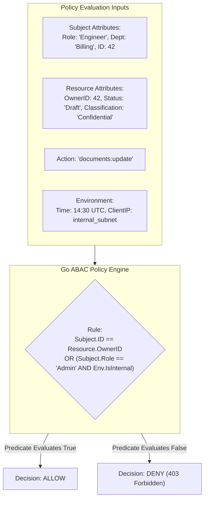

# ABAC and policy checks

## Learning objective

Implement attribute-based access control in Go using policy rules that evaluate user attributes, resource attributes, and environmental context to make fine-grained authorization decisions.

## Why this matters

RBAC answers "what role does the user have?" but cannot answer "can this user in this department edit this document during business hours from this IP range?" ABAC answers those questions by evaluating policies against any relevant attribute — user department, resource classification, time of day, geographic location, device type. AWS IAM, Google Cloud IAM, and Kubernetes use ABAC for fine-grained access control. In Go services, ABAC enables resource-level authorization that adapts to complex business rules without hardcoding conditionals in handlers.

## Mental model

ABAC is a security guard with a rulebook. The guard checks: who you are (user attributes), what you want to access (resource attributes), and the situation (environment attributes). The rulebook says: "Allow employees to view documents in their own department during work hours. Allow managers to view any document in their org. Deny all access from outside the corporate network." The guard does not memorize every rule — they consult the rulebook (policy engine) for every decision.

## Visual model



## Core idea

ABAC makes decisions based on three attribute categories:

| Category | Examples | Source |
|---|---|---|
| User attributes | department, clearance, role, location | Auth token, user DB |
| Resource attributes | classification, owner, tenant_id | Resource metadata |
| Environment attributes | time of day, IP range, HTTP method | Request context |

A policy rule is a boolean expression over these attributes:

```
ALLOW when:
  user.department == resource.department
  AND resource.classification <= user.clearance
  AND env.time between "09:00" AND "17:00"
  AND env.ip in corporate_cidr
```

ABAC and RBAC are complementary:

- RBAC: "editor role can delete documents" (coarse, role-based).
- ABAC: "editor role can delete documents they own, in their department, during business hours, from the office network" (fine-grained, attribute-based).

## Under the hood

A policy engine evaluates rules against a set of attributes. The simplest implementation is a list of policy rules, each with conditions and an effect (allow/deny):

```go
type PolicyRule struct {
    Name       string
    Effect     string // "allow" or "deny"
    Conditions []Condition
}

type Condition struct {
    Attribute string // "user.department"
    Operator  string // "eq", "neq", "in", "contains"
    Value     interface{}
}
```

The evaluator runs two passes: it checks every `deny` rule first, then the first matching `allow` rule, and falls through to a default-deny. Deny therefore overrides allow regardless of rule order - the security-correct semantics (reordering rules must not change the outcome).

In production, policy engines use:

- **Casbin**: a full-featured policy engine with ABAC support.
- **OPA (Open Policy Agent)**: a general-purpose policy engine with Rego language.
- **Custom evaluators**: for simple attribute checks without the complexity of a full engine.

## How Go uses it

Go does not have a built-in ABAC engine, but the ecosystem provides several options:

- **Casbin (`github.com/casbin/casbin/v2`)**: supports RBAC, ABAC, and custom policy models. Policies are stored in files or databases.
- **OPA (`github.com/open-policy-agent/opa`)**: runs as a sidecar or embedded library. Policies are written in Rego.
- **Custom ABAC**: for simple use cases, a Go map of policy rules with condition evaluators is sufficient.

The common pattern is to evaluate policies at the middleware layer, after authentication and basic RBAC:

```go
func ABACMiddleware(policyEngine *PolicyEngine) func(http.Handler) http.Handler {
    return func(next http.Handler) http.Handler {
        return http.HandlerFunc(func(w http.ResponseWriter, r *http.Request) {
            attrs := collectAttributes(r)
            if !policyEngine.Evaluate(attrs) {
                http.Error(w, "forbidden", http.StatusForbidden)
                return
            }
            next.ServeHTTP(w, r)
        })
    }
}
```

## Go example

```go
package main

import (
	"encoding/json"
	"errors"
	"fmt"
	"log"
	"net/http"
	"strings"
	"sync"
	"time"
)

type Attributes struct {
	UserDepartment     string `json:"user_department"`
	UserClearance      int    `json:"user_clearance"`
	UserRole           string `json:"user_role"`
	ResourceDepartment string `json:"resource_department"`
	ResourceOwner      string `json:"resource_owner"`
	ResourceClass      int    `json:"resource_class"`
	EnvTime            string `json:"env_time"`
	EnvMethod          string `json:"env_method"`
	EnvIP              string `json:"env_ip"`
	EnvTenantID        string `json:"env_tenant_id"`
}

type Condition struct {
	Attribute string      `json:"attribute"`
	Operator  string      `json:"operator"`
	Value     interface{} `json:"value"`
}

type PolicyRule struct {
	Name       string      `json:"name"`
	Effect     string      `json:"effect"`
	Conditions []Condition `json:"conditions"`
}

type PolicyEngine struct {
	mu    sync.RWMutex
	rules []PolicyRule
}

func NewPolicyEngine() *PolicyEngine {
	return &PolicyEngine{}
}

func (pe *PolicyEngine) AddRule(rule PolicyRule) {
	pe.mu.Lock()
	defer pe.mu.Unlock()
	pe.rules = append(pe.rules, rule)
}

func (pe *PolicyEngine) Evaluate(attrs *Attributes) (bool, string, error) {
	pe.mu.RLock()
	defer pe.mu.RUnlock()
	// Pass 1: explicit deny always wins, regardless of rule order.
	for _, rule := range pe.rules {
		if rule.Effect != "deny" {
			continue
		}
		matches, err := evaluateConditions(rule.Conditions, attrs)
		if err != nil {
			return false, rule.Name, err
		}
		if matches {
			return false, rule.Name, nil
		}
	}
	// Pass 2: first matching allow rule.
	for _, rule := range pe.rules {
		if rule.Effect != "allow" {
			continue
		}
		matches, err := evaluateConditions(rule.Conditions, attrs)
		if err != nil {
			return false, rule.Name, err
		}
		if matches {
			return true, rule.Name, nil
		}
	}
	return false, "default-deny", nil
}

func evaluateConditions(conditions []Condition, attrs *Attributes) (bool, error) {
	for _, c := range conditions {
		attrValue, err := getAttributeValue(c.Attribute, attrs)
		if err != nil {
			return false, err
		}
		resolved := resolveValue(c.Value, attrs)
		ok, err := evaluateCondition(c.Operator, attrValue, resolved)
		if err != nil {
			return false, err
		}
		if !ok {
			return false, nil
		}
	}
	return true, nil
}

func getAttributeValue(attr string, attrs *Attributes) (interface{}, error) {
	switch attr {
	case "user.department":
		return attrs.UserDepartment, nil
	case "user.clearance":
		return attrs.UserClearance, nil
	case "user.role":
		return attrs.UserRole, nil
	case "resource.department":
		return attrs.ResourceDepartment, nil
	case "resource.owner":
		return attrs.ResourceOwner, nil
	case "resource.class":
		return attrs.ResourceClass, nil
	case "env.time":
		return attrs.EnvTime, nil
	case "env.method":
		return attrs.EnvMethod, nil
	case "env.ip":
		return attrs.EnvIP, nil
	case "env.tenant_id":
		return attrs.EnvTenantID, nil
	default:
		return nil, fmt.Errorf("unknown attribute: %s", attr)
	}
}

// resolveValue resolves attribute references like "${user.department}".
func resolveValue(v interface{}, attrs *Attributes) interface{} {
	s, ok := v.(string)
	if !ok || !strings.HasPrefix(s, "${") || !strings.HasSuffix(s, "}") {
		return v
	}
	attr := strings.TrimSuffix(strings.TrimPrefix(s, "${"), "}")
	val, err := getAttributeValue(attr, attrs)
	if err != nil {
		return v
	}
	return val
}

func evaluateCondition(op string, actual, expected interface{}) (bool, error) {
	switch op {
	case "eq":
		return fmt.Sprintf("%v", actual) == fmt.Sprintf("%v", expected), nil
	case "neq":
		return fmt.Sprintf("%v", actual) != fmt.Sprintf("%v", expected), nil
	case "gt":
		return toFloat(actual) > toFloat(expected), nil
	case "gte":
		return toFloat(actual) >= toFloat(expected), nil
	case "lt":
		return toFloat(actual) < toFloat(expected), nil
	case "lte":
		return toFloat(actual) <= toFloat(expected), nil
	case "in":
		return inList(actual, expected)
	case "contains":
		return strings.Contains(fmt.Sprintf("%v", actual), fmt.Sprintf("%v", expected)), nil
	default:
		return false, fmt.Errorf("unknown operator: %s", op)
	}
}

func toFloat(v interface{}) float64 {
	switch val := v.(type) {
	case float64:
		return val
	case int:
		return float64(val)
	}
	return 0
}

func inList(actual interface{}, expected interface{}) (bool, error) {
	list, ok := expected.([]interface{})
	if !ok {
		return false, errors.New("in operator requires a list value")
	}
	for _, item := range list {
		if fmt.Sprintf("%v", actual) == fmt.Sprintf("%v", item) {
			return true, nil
		}
	}
	return false, nil
}

func EvaluatePolicy(pe *PolicyEngine, userDept, userClearance string, resourceDept string, resourceClass int, method string) (bool, string) {
	clearance := 0
	if userClearance == "admin" {
		clearance = 99
	} else {
		fmt.Sscanf(userClearance, "%d", &clearance)
	}
	attrs := &Attributes{
		UserDepartment:     userDept,
		UserClearance:      clearance,
		UserRole:           userClearance,
		ResourceDepartment: resourceDept,
		ResourceClass:      resourceClass,
		EnvMethod:          method,
		EnvTime:            time.Now().Format("15:04"),
		EnvIP:              "10.0.0.1",
	}
	allowed, rule, _ := pe.Evaluate(attrs)
	return allowed, rule
}

func main() {
	pe := NewPolicyEngine()

	// Admin override must come first (break-glass policy).
	pe.AddRule(PolicyRule{
		Name: "admin-override", Effect: "allow",
		Conditions: []Condition{
			{Attribute: "user.role", Operator: "eq", Value: "admin"},
		},
	})
	pe.AddRule(PolicyRule{
		Name: "same-dept", Effect: "allow",
		Conditions: []Condition{
			{Attribute: "user.department", Operator: "eq", Value: "${resource.department}"},
			{Attribute: "env.method", Operator: "eq", Value: "GET"},
		},
	})
	pe.AddRule(PolicyRule{
		Name: "clearance", Effect: "allow",
		Conditions: []Condition{
			{Attribute: "user.clearance", Operator: "gte", Value: 3},
			{Attribute: "env.method", Operator: "eq", Value: "GET"},
		},
	})
	pe.AddRule(PolicyRule{
		Name: "deny-delete", Effect: "deny",
		Conditions: []Condition{
			{Attribute: "env.method", Operator: "eq", Value: "DELETE"},
			{Attribute: "user.role", Operator: "neq", Value: "admin"},
		},
	})

	scenarios := []struct {
		name            string
		userDept        string
		userClearance   string
		resourceDept    string
		resourceClass   int
		method          string
		expectedAllowed bool
	}{
		{"Same dept GET", "engineering", "3", "engineering", 2, "GET", true},
		{"Different dept low clearance", "engineering", "1", "finance", 3, "GET", false},
		{"Admin override", "engineering", "admin", "finance", 5, "DELETE", true},
		{"High clearance different dept", "engineering", "5", "finance", 3, "GET", true},
		{"DELETE denied", "engineering", "3", "engineering", 2, "DELETE", false},
	}

	for _, s := range scenarios {
		allowed, rule := EvaluatePolicy(pe, s.userDept, s.userClearance, s.resourceDept, s.resourceClass, s.method)
		status := "PASS"
		if allowed != s.expectedAllowed {
			status = "FAIL"
		}
		fmt.Printf("[%s] %s: allowed=%v (rule: %s)\n", status, s.name, allowed, rule)
	}

	// HTTP
	http.HandleFunc("/api/documents/", func(w http.ResponseWriter, r *http.Request) {
		attrs := &Attributes{
			UserDepartment:     r.Header.Get("X-Department"),
			UserClearance:      3,
			UserRole:           r.Header.Get("X-Role"),
			ResourceDepartment: r.URL.Query().Get("department"),
			ResourceClass:      2,
			EnvMethod:          r.Method,
			EnvTime:            time.Now().Format("15:04"),
			EnvIP:              r.RemoteAddr,
		}
		allowed, rule, _ := pe.Evaluate(attrs)
		if !allowed {
			w.Header().Set("X-Deny-Reason", rule)
			http.Error(w, `{"error":"forbidden"}`, http.StatusForbidden)
			return
		}
		json.NewEncoder(w).Encode(map[string]string{"status": "access granted"})
	})

	fmt.Println("\nABAC server on :8080")
	log.Fatal(http.ListenAndServe(":8080", nil))
}
```

## Step-by-step execution

For scenario "Same department, GET request":

1. `Evaluate` iterates policy rules in order.
2. Rule "same-department-read": conditions check `env.method == "GET"` (true), `user.department == resource.department` (engineering == engineering, true), and tenant match. All match -> effect "allow". Returns `(true, "same-department-read", nil)`.

For scenario "Different department, no clearance":

1. Rule "same-department-read": engineering != finance -> condition fails. Skip.
2. Rule "clearance-based-access": `user.clearance (1) >= resource.class (3)` -> false. Skip.
3. Rule "corporate-ip-only": `env.ip == "10.0.0.1"` -> matches, effect "deny". Returns `(false, "corporate-ip-only", nil)`.

For scenario "Admin overrides":

1. Rule "same-department-read": engineering != finance -> skip.
2. Rule "clearance-based-access": method is DELETE, not GET -> skip.
3. Rule "corporate-ip-only": IP is "192.168.1.1", not "10.0.0.1" -> skip.
4. Rule "admin-override": `user.role == "admin"` -> matches, effect "allow". Returns `(true, "admin-override", nil)`.

## Common mistakes

- Implementing ABAC without a policy engine, leading to convoluted if-else chains in handlers.
- Mixing attribute definitions across layers — defining resource ownership in the handler instead of the policy layer.
- Writing policies that are too permissive because of missing attribute constraints.
- Failing to audit policy evaluation results — ABAC decisions are hard to debug without logs.
- Using ABAC for everything when RBAC would suffice — ABAC adds complexity. Use RBAC for coarse checks, ABAC for fine-grained overrides.
- Not testing deny rules — a misconfigured allow rule is a vulnerability; a misconfigured deny rule is an outage.

## Debugging walkthrough

Consider this ABAC check embedded in a handler:

```go
func documentHandler(w http.ResponseWriter, r *http.Request) {
    user := getUser(r)
    doc := getDocument(r)
    // Inline policy: user can edit if owner or admin
    if user.ID != doc.OwnerID && user.Role != "admin" {
        http.Error(w, "forbidden", http.StatusForbidden)
        return
    }
    // ... process document ...
}
```

**Symptom**: The business wants to add a rule: "managers can edit documents in their department even if not the owner." The developer adds another condition. Then "managers can only edit during business hours." More conditions. Soon:

```go
if user.ID == doc.OwnerID || user.Role == "admin" ||
    (user.Role == "manager" && user.Department == doc.Department && hour >= 9 && hour < 17 && ...) {
```

**Investigation**: The inline condition is unreadable, untestable, and unmaintainable. It cannot be audited. There is no policy documentation — the logic is only in the code.

**Root cause**: ABAC logic embedded in handler code instead of a policy engine.

**Fix**: Extract into policy rules:

```go
policy.AddRule(PolicyRule{
    Name:   "owner-edits",
    Effect: "allow",
    Conditions: []Condition{
        {Attribute: "user.id", Operator: "eq", Value: "${resource.owner}"},
    },
})
policy.AddRule(PolicyRule{
    Name:   "department-manager-edits",
    Effect: "allow",
    Conditions: []Condition{
        {Attribute: "user.role", Operator: "eq", Value: "manager"},
        {Attribute: "user.department", Operator: "eq", Value: "${resource.department}"},
        {Attribute: "env.hour", Operator: "gte", Value: 9},
        {Attribute: "env.hour", Operator: "lt", Value: 17},
    },
})
```

## Production notes

- Use a dedicated policy engine (OPA, Casbin) for anything beyond simple attribute checks. Rego (OPA's policy language) is purpose-built for ABAC.
- Cache policy evaluation results when attributes are stable (e.g., same user, same resource, same time window).
- Log every ABAC decision with all attributes for audit. Use structured logging (user, resource, action, decision, rule name).
- Version your policies. A policy change is a security change — it should go through code review and deployment.
- Start with a default-deny policy and add allow rules. Explicit deny rules should be rare and used for blocking known bad actors.

## Performance implications

- Simple ABAC evaluation (10 rules, 5 conditions each): < 10 microseconds.
- OPA sidecar evaluation: 1-10ms per request (HTTP call to OPA). Embedding OPA as a library reduces this to ~100 microseconds.
- Casbin evaluation: 10-100 microseconds depending on policy size.
- Attribute collection overhead: depends on the source. Database lookup for attributes adds 5-50ms. HTTP header attributes are free.
- For high-throughput services, evaluate ABAC at the gateway level and pass the decision downstream.

## Practice task

Write Go functions `NewPolicyEngine()` and `EvaluatePolicy(pe *PolicyEngine, userDept, userClearance string, resourceDept string, resourceClass int, method string) (bool, string)` where:
- Define a policy: allow access if `user.department == resource.department` AND `method == "GET"`.
- Define a second policy: allow access if `userClearance >= resourceClass`.
- Define a third policy: deny all DELETE requests.
- Admin users (userClearance == "admin") bypass all restrictions.
- Then write a `main()` that tests 6 scenarios and prints which rule matched.

## Tests / verification

```bash
go run ./curriculum/modules/10-auth-security/lessons/12-abac-and-policy-checks
go test ./curriculum/modules/10-auth-security/lessons/12-abac-and-policy-checks
```

The test file `main_test.go` contains table-driven tests that verify:
- `EvaluatePolicy` returns (true, "same-dept") for same department GET.
- `EvaluatePolicy` returns (true, "clearance") for high-clearance GET.
- `EvaluatePolicy` returns (false, "deny-delete") for DELETE requests.
- `EvaluatePolicy` returns (true, "admin-override") for admin users regardless of other conditions.

## Review questions

1. What are the three categories of attributes in ABAC? Give examples of each.
2. How does ABAC differ from RBAC? When would you use one versus the other?
3. Why should ABAC policies use a policy engine rather than inline if-else conditions in handler code?
4. In the example, why does the "admin-override" rule come last? What would happen if it were first?
5. How would you debug a situation where a user is unexpectedly denied access by an ABAC policy?

## NEXT UP

[Tenant Isolation Basics](../13-tenant-isolation-basics/README.md)
