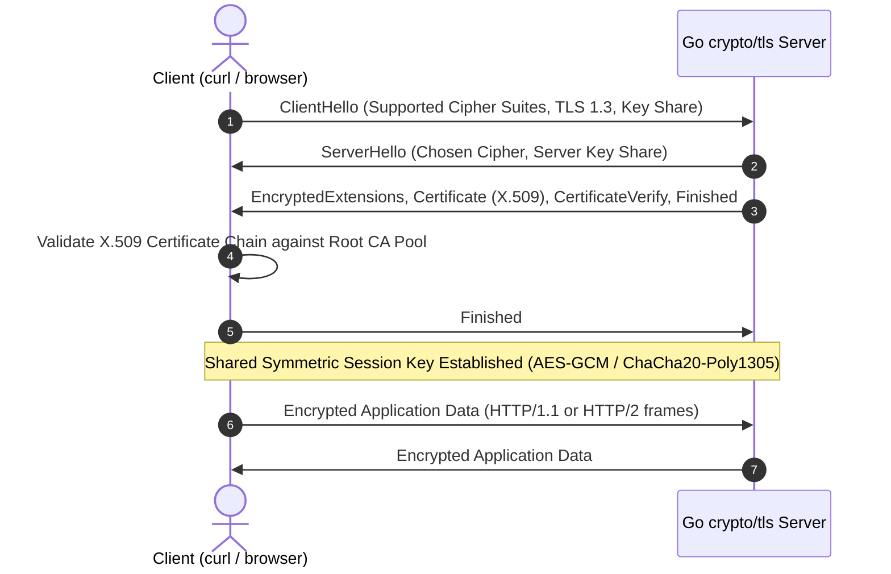

# TLS and HTTPS

## Learning objective

Configure TLS certificates for Go HTTP servers, understand the TLS handshake process, generate self-signed certificates for development, and enforce secure HTTPS connections with modern cipher suites.

## Why this matters

HTTPS is not optional. Every production web service must use TLS to encrypt data in transit, prevent man-in-the-middle attacks, and protect user privacy. Browsers mark HTTP sites as "not secure." Regulations (GDPR, PCI-DSS, HIPAA) require encryption in transit. Go's `crypto/tls` package provides a reliable, production-ready TLS implementation used by Kubernetes, Docker, and major Go web frameworks. Go engineers must know how to configure TLS servers, generate certificates, and enforce secure defaults.

## Mental model

TLS is a sealed pipe between client and server. Before any application data flows, the client and server perform a handshake to agree on encryption keys and verify each other's identity. The server presents a certificate -- like a passport -- issued by a trusted authority (Certificate Authority, or CA). The client checks the passport's validity, expiration, and domain match before sending data through the pipe.

HTTPS is HTTP running inside this TLS pipe. The HTTP traffic is invisible to anyone monitoring the connection.

## Visual model



## Core idea

TLS provides three guarantees:

1. **Encryption**: Data is encrypted so eavesdroppers cannot read it.
2. **Authentication**: The server proves its identity via a certificate signed by a trusted CA.
3. **Integrity**: Data cannot be modified in transit without detection.

Key TLS concepts:

| Term | Definition |
|---|---|
| Certificate | Digital document binding a public key to an entity (domain, organization) |
| Certificate Authority (CA) | Trusted third party that signs certificates |
| Certificate chain | Certificate signed by intermediate CA, which is signed by root CA |
| Private key | Secret key used to decrypt and sign; never shared |
| Public key | Included in certificate; used to encrypt and verify signatures |
| TLS handshake | Protocol exchange to establish encrypted session |
| SNI (Server Name Indication) | TLS extension allowing multiple certificates on one IP |

## Under the hood

The TLS 1.3 handshake (two round trips, reduced from TLS 1.2's four):

1. **ClientHello**: Client sends supported TLS versions, cipher suites, and a random nonce.
2. **ServerHello**: Server selects TLS version and cipher suite, sends its certificate chain, and performs key exchange (ECDHE).
3. **Key Exchange**: Both parties compute the session key using ephemeral Diffie-Hellman (ECDHE), providing forward secrecy.
4. **Finished**: Both sides verify the handshake was tamper-free, then begin encrypted application data.

TLS 1.3 removes insecure features: RSA key exchange (no forward secrecy), static DH, CBC mode ciphers, and compression.

```text
Client                              Server
  |-------ClientHello--------------->|
  |<----ServerHello+Cert+KeyEx-------|
  |<----Finished (encrypted)---------|
  |-------Finished (encrypted)------->|
  |=======Encrypted Application======|
```

## How Go uses it

Go's `crypto/tls` package provides TLS configuration and connections. The `net/http` package can create TLS servers using `http.Server` with `TLSConfig`.

Key patterns:

```go
// TLS server with configuration
server := &http.Server{
    Addr:      ":443",
    Handler:   mux,
    TLSConfig: &tls.Config{
        MinVersion: tls.VersionTLS12,
        CipherSuites: []uint16{
            tls.TLS_ECDHE_RSA_WITH_AES_128_GCM_SHA256,
        },
    },
}
server.ListenAndServeTLS("cert.pem", "key.pem")
```

For development, Go can generate self-signed certificates using `crypto/x509` and `crypto/rsa`. For production, use Let's Encrypt via `autocert` (`golang.org/x/crypto/acme/autocert`) for automated certificate issuance and renewal.

## Go example

```go
package main

import (
	"crypto/rand"
	"crypto/rsa"
	"crypto/tls"
	"crypto/x509"
	"crypto/x509/pkix"
	"encoding/pem"
	"fmt"
	"io"
	"math/big"
	"net"
	"net/http"
	"net/http/httptest"
	"time"
)

func generateCert() (tls.Certificate, error) {
	key, err := rsa.GenerateKey(rand.Reader, 2048)
	if err != nil {
		return tls.Certificate{}, err
	}

	template := x509.Certificate{
		SerialNumber: big.NewInt(1),
		Subject: pkix.Name{
			Organization: []string{"Go Engineer Lesson"},
			CommonName:   "localhost",
		},
		NotBefore:             time.Now(),
		NotAfter:              time.Now().Add(365 * 24 * time.Hour),
		KeyUsage:              x509.KeyUsageKeyEncipherment | x509.KeyUsageDigitalSignature,
		ExtKeyUsage:           []x509.ExtKeyUsage{x509.ExtKeyUsageServerAuth},
		BasicConstraintsValid: true,
		DNSNames:              []string{"localhost"},
		IPAddresses:           []net.IP{net.ParseIP("127.0.0.1"), net.ParseIP("::1")},
	}

	certDER, err := x509.CreateCertificate(rand.Reader, &template, &template, &key.PublicKey, key)
	if err != nil {
		return tls.Certificate{}, err
	}

	certPEM := pem.EncodeToMemory(&pem.Block{Type: "CERTIFICATE", Bytes: certDER})
	keyPEM := pem.EncodeToMemory(&pem.Block{Type: "RSA PRIVATE KEY", Bytes: x509.MarshalPKCS1PrivateKey(key)})

	return tls.X509KeyPair(certPEM, keyPEM)
}

func serverConfig() *tls.Config {
	cert, err := generateCert()
	if err != nil {
		panic(err)
	}
	return &tls.Config{
		Certificates: []tls.Certificate{cert},
		MinVersion:   tls.VersionTLS12,
	}
}

func clientConfig(serverCert *x509.Certificate) *tls.Config {
	// Trust the demo server by adding its certificate to the pool -
	// never InsecureSkipVerify, which silently disables all verification.
	pool := x509.NewCertPool()
	pool.AddCert(serverCert)
	return &tls.Config{
		RootCAs:    pool,
		MinVersion: tls.VersionTLS12,
	}
}

func main() {
	fmt.Println("=== TLS Server Demo ===")
	fmt.Println("Generating self-signed certificate...")

	tlsConfig := serverConfig()
	mux := http.NewServeMux()
	mux.HandleFunc("/hello", func(w http.ResponseWriter, r *http.Request) {
		w.Header().Set("Content-Type", "application/json")
		w.Write([]byte(`{"message":"Hello over TLS!"}`))
	})

	ts := httptest.NewUnstartedServer(mux)
	ts.TLS = tlsConfig
	ts.StartTLS()
	defer ts.Close()

	fmt.Println("TLS server at:", ts.URL)

	serverCert := tlsConfig.Certificates[0].Leaf
	if serverCert == nil {
		panic("parsed leaf certificate unavailable")
	}
	client := &http.Client{
		Transport: &http.Transport{
			TLSClientConfig: clientConfig(serverCert),
		},
	}

	resp, err := client.Get(ts.URL + "/hello")
	if err != nil {
		panic(err)
	}
	defer resp.Body.Close()

	body, _ := io.ReadAll(resp.Body)
	fmt.Println("Response:", string(body))
	fmt.Println("TLS version:", resp.TLS.Version)
	fmt.Println("Server cert CN:", resp.TLS.PeerCertificates[0].Subject.CommonName)

	fmt.Println("\n=== TLS config check ===")
	cfg := tlsConfig
	fmt.Printf("MinVersion: %d (TLS 1.2=%d, TLS 1.3=%d)\n", cfg.MinVersion, tls.VersionTLS12, tls.VersionTLS13)
	fmt.Printf("Certificates: %d\n", len(cfg.Certificates))
}
```

## Step-by-step execution

When a browser connects to `https://example.com`:

1. Browser resolves `example.com` to an IP address and opens a TCP connection on port 443.
2. Browser sends ClientHello: supported TLS versions (1.3, 1.2), cipher suites (AES-GCM, ChaCha20), and a random 32-byte nonce.
3. Server responds with ServerHello: selects TLS 1.3 and `TLS_AES_128_GCM_SHA256`. Sends its certificate chain (leaf cert + intermediates).
4. Browser verifies the certificate chain against its root CA store. Checks: valid signature, not expired, domain matches `example.com`, not revoked.
5. Both sides perform ECDHE key exchange. They compute the same session key without ever sending it over the wire.
6. Browser sends Finished message encrypted with the session key.
7. Server decrypts, verifies, and sends its Finished message.
8. Handshake complete. Application data flows over the encrypted connection.
9. Browser shows the padlock icon.

## Common mistakes

- Mistake: Using self-signed certificates in production without proper certificate pinning.
  - Why it happens: Developers generate a self-signed cert for testing and forget to replace it.
  - Fix: Use Let's Encrypt for production. Self-signed certs trigger browser warnings and are not trusted by clients.

- Mistake: Setting `InsecureSkipVerify: true` in production client code.
  - Why it happens: Developers bypass certificate validation to make errors go away during development.
  - Fix: Never skip verification - not even in examples. The lesson demo trusts its self-signed server by adding the certificate to a `RootCAs` pool; real clients configure proper root CAs for internal certificates.

- Mistake: Using outdated TLS versions (TLS 1.0, 1.1) that are vulnerable to protocol downgrade attacks.
  - Why it happens: Default Go TLS config allows all versions if not explicitly set.
  - Fix: Always set `MinVersion: tls.VersionTLS12` or `tls.VersionTLS13`.

- Mistake: Not setting HSTS headers, leaving users vulnerable to SSL-stripping attacks.
  - Why it happens: Developers think TLS alone is sufficient.
  - Fix: Set the `Strict-Transport-Security` header: `max-age=31536000; includeSubDomains`.

- Mistake: Exposing the private key file with world-readable permissions.
  - Why it happens: Developers leave key files with default permissions.
  - Fix: Private key files should be readable only by the application user (`chmod 600`).

## Debugging walkthrough

Consider this broken TLS configuration:

```go
server := &http.Server{
    Addr:    ":443",
    Handler: mux,
}
err := server.ListenAndServeTLS("cert.pem", "key.pem")
```

Symptom: Browsers report "ERR_CERT_COMMON_NAME_INVALID" and refuse to connect.

Investigation: Examine the certificate:

```bash
openssl x509 -in cert.pem -text -noout | grep Subject:
# Subject: CN = example.com
```

But the site is accessed at `www.example.com`. The certificate does not include `www.example.com` in its SAN (Subject Alternative Name).

Root cause: The certificate was issued for `example.com` but not `www.example.com`. Modern browsers require SAN matching, and CN fallback is deprecated.

Fix: Regenerate the certificate with both DNS names:

```go
template.DNSNames = []string{"example.com", "www.example.com"}
```

## Production notes

- Use Let's Encrypt with the `autocert` package for automatic certificate management. It handles issuance, renewal, and HTTP-01 challenges.
- Set `MinVersion: tls.VersionTLS12` and prefer TLS 1.3 cipher suites.
- Always redirect HTTP (port 80) to HTTPS (port 443) using a separate server.
- Set HSTS header with `max-age=31536000; includeSubDomains; preload` after testing.
- Enable OCSP stapling to improve certificate revocation checking performance.
- Monitor certificate expiration. Set alerts for 30, 14, and 7 days before expiry.
- Use a reverse proxy (Nginx, Caddy) for TLS termination in production; Go's TLS implementation is production-ready but a proxy adds defense-in-depth.

## Performance implications

- TLS 1.3 handshake adds approximately 1 round trip (vs. 2 for TLS 1.2) compared to plain HTTP.
- Initial handshake is CPU-intensive due to asymmetric cryptography (RSA or ECDSA signature verification).
- Session resumption (session tickets or session IDs) eliminates the full handshake for returning clients, reducing the cost to 0 RTT (TLS 1.3 0-RTT mode) or 1 RTT.
- AES-GCM cipher suites are hardware-accelerated on modern CPUs. The performance overhead of TLS is typically 1-5% of CPU for most applications.
- Connection reuse (keep-alive) amortizes the handshake cost across many requests.

## Practice task

Write a function `newTLSServer(handler http.Handler) *http.Server` that:

1. Generates a self-signed certificate for `localhost` and `127.0.0.1`.
2. Configures TLS with `MinVersion = tls.VersionTLS12` and a restricted set of secure cipher suites.
3. Returns an `*http.Server` with the TLS config.

Then write a `main()` that creates a server with a simple handler ("Hello, TLS!"), starts it on a random port, makes an HTTPS request using a client with `InsecureSkipVerify: true`, and prints the response and TLS version.

## Tests / verification

```bash
go run ./curriculum/modules/10-auth-security/lessons/19-tls-and-https
go test ./curriculum/modules/10-auth-security/lessons/19-tls-and-https
```

The existing tests verify certificate generation produces valid certificates for localhost, TLS servers respond correctly, and minimum TLS version enforcement works.

## Review questions

1. What are the three guarantees provided by TLS, and how does each protect against specific attacks?
2. How does the TLS 1.3 handshake differ from TLS 1.2 in terms of round trips and security properties?
3. What is forward secrecy and how does ECDHE provide it?
4. Why should you set `MinVersion: tls.VersionTLS12` instead of using Go's default?
5. What is the difference between a self-signed certificate and a CA-signed certificate, and when would you use each?

## NEXT UP

[Secrets Management](../20-secrets-management/README.md)
