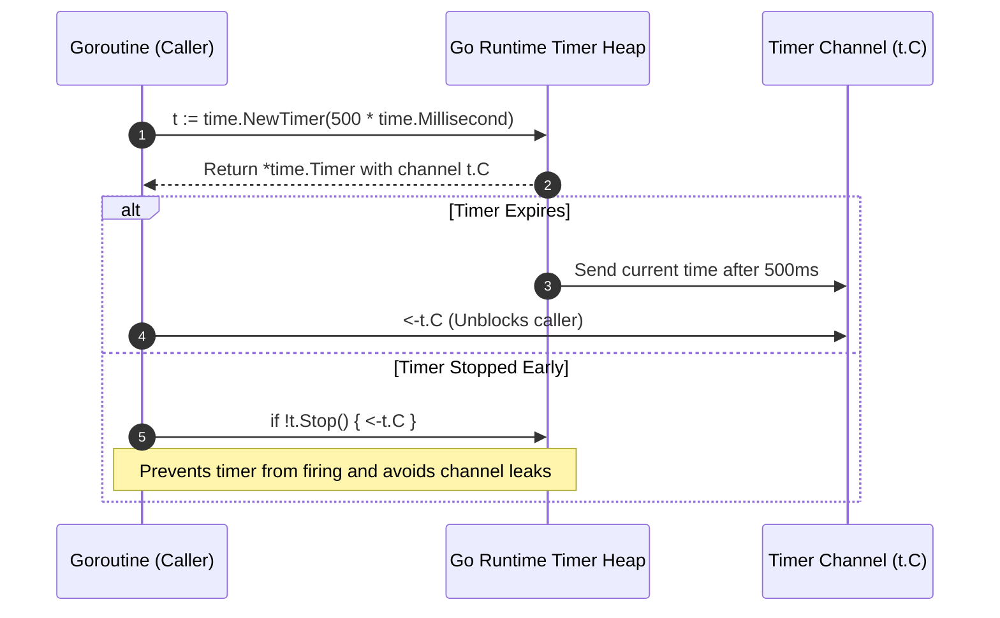

# Timers

## Learning objective

Create, stop, and reset one-shot timed events using `time.NewTimer`, `time.After`, `timer.Stop`, and `timer.Reset` in concurrent Go programs.

## Why this matters

Timers are the building block for timeouts, retries, heartbeat intervals, and delayed task execution. Every production Go service uses timers — in HTTP client timeouts, database connection retries, graceful shutdown windows, and rate-limit backoff. Misusing timers leaks goroutines or causes premature timeouts that cascade into system failures.

## Mental model

A timer is a one-shot alarm that fires exactly once after a specified duration. Think of it as a countdown that sends a pulse on a channel when it reaches zero. You can cancel the alarm before it rings (`Stop`), or rewind it to count down from a new duration (`Reset`). On Go 1.23+ the channel is unbuffered and `Reset` waits for the new deadline — no draining required. (Before Go 1.23, a fired-but-unreceived value sat in a buffered channel, and the doctrine was to drain before resetting.)

## Visual model



## Core idea

`time.NewTimer(d)` creates a `*time.Timer` with a `C` channel (`<-chan time.Time`) that receives the current time when `d` elapses.

Key timer operations:

| Operation | Behavior |
|---|---|
| `time.NewTimer(d)` | Creates a timer that fires after `d` |
| `<-timer.C` | Blocks until timer fires (or returns immediately if already fired) |
| `timer.Stop()` | Prevents a future firing; in Go 1.23+ the return value no longer tells you whether a value is pending on the channel |
| `timer.Reset(d)` | Rearms the timer to fire after `d`; on Go 1.23+ no channel draining is required |
| `time.After(d)` | Returns a channel directly, equivalent to `NewTimer(d).C` |

## Under the hood

Each `time.Timer` is managed by the Go runtime's timer heap (a min-heap keyed by absolute wake time). Internally, a `timer` struct contains the fire time, period (for tickers), the channel to send on, and a callback function. When `NewTimer` is called, the runtime inserts the timer into the heap. The scheduler's `sysmon` thread periodically checks the heap and fires timers whose deadline has passed by sending on their channel. `Stop` removes the timer from the heap. `Reset` removes and re-inserts with the new duration.

## How Go uses it

- `net/http`: `Transport` timeouts (`DialContext` deadlines, `ResponseHeaderTimeout`) are enforced by deadline-based timers inside the net package, not by `time.After` in your code.
- `context`: `WithTimeout` creates a timer via `time.AfterFunc` that calls the cancel function.
- `database/sql`: Connection retry loops use timers for backoff intervals.
- `os/signal`: Signal notification uses a channel pattern analogous to timers.

## Go example

```go
package main

import (
	"fmt"
	"time"
)

func main() {
	timer := time.NewTimer(1 * time.Second)
	start := time.Now()
	<-timer.C
	fmt.Println("Timer fired after:", time.Since(start).Round(time.Millisecond))

	timer2 := time.NewTimer(500 * time.Millisecond)
	stopped := timer2.Stop()
	if stopped {
		fmt.Println("Timer stopped before firing")
	}

	timer3 := time.NewTimer(1 * time.Second)
	go func() {
		<-timer3.C
		fmt.Println("Timer 3 fired")
	}()
	time.Sleep(100 * time.Millisecond)
	reset := timer3.Reset(2 * time.Second)
	fmt.Println("Timer 3 reset, was active:", reset)
	time.Sleep(2500 * time.Millisecond)

	select {
	case <-time.After(100 * time.Millisecond):
		fmt.Println("time.After fired")
	}
}
```

## Step-by-step execution

1. `time.NewTimer(1 * time.Second)` allocates a `Timer` struct and inserts it into the runtime heap with a deadline 1s from now.
2. `<-timer.C` blocks the main goroutine. The scheduler parks it. After 1s, `sysmon` or the P's timer goroutine sends `time.Now()` on `timer.C`. The main goroutine is made runnable again.
3. `timer2.Stop()` removes the timer from the heap before it fires, preventing the channel send. Returns `true` because the timer was active.
4. `timer3.Reset(2 * time.Second)` removes and re-inserts `timer3` with a new deadline 2s from now. Returns `true` because the timer had not yet fired.
5. `time.After(100 * time.Millisecond)` is shorthand: `NewTimer(d).C`. It creates a timer and immediately returns its channel.

## Common mistakes

- Mistake (pre-Go-1.23 doctrine, obsolete on modern Go): Draining the channel before `Reset`.
  - Why (historical): Before Go 1.23, `Timer` channels were buffered, so a fired-but-unreceived value sat in the channel and was delivered immediately after `Reset`.
  - Fix: On Go 1.23+ the channel is unbuffered and `Reset` on a fired-but-unreceived timer waits for the **new** deadline — verified on go1.27 (a 300ms reset waited 300ms, no stale delivery). The old `if !timer.Stop() { <-timer.C }` dance is unnecessary in code that only targets Go 1.23+; keep it only in code that must run on older Go.

- Mistake: Forgetting to stop a timer after use (pre-Go-1.23 concern).
  - Why: Before Go 1.23, an unreferenced timer stayed in the runtime heap until it fired. On Go 1.23+, a timer no longer referenced by any code becomes garbage-collectible immediately — but `Stop` is still the explicit-cleanup idiom, and any goroutine blocked on the channel keeps the timer alive.
  - Fix: Prefer `defer timer.Stop()` when the timer lifetime is tied to a function scope.

- Mistake: Using `time.After` in a loop that recreates it every iteration.
  - Why: Each iteration allocates a new timer that stays alive until it fires; in a long-running loop with large timeouts, many timers can accumulate (on Go 1.23+ unreferenced ones are GC-eligible, but the churn remains wasteful).
  - Fix: Use `time.NewTimer` once and call `Reset` per iteration.

- Mistake: Assuming `Stop`'s return value tells you whether a value is pending.
  - Why: On Go 1.23+ the return value no longer maps to "value pending" — verified on go1.27: `Stop` returned `true` for an already-fired timer and no value was ever delivered afterward. Pre-1.23, `false` meant fired-and-possibly-buffered.
  - Fix: On modern Go, treat `Stop` as cleanup only; do not branch on its return value for channel draining.

## Debugging walkthrough

Consider a HTTP client timeout that is not respected:

```go
func fetchWithTimeout(url string, timeout time.Duration) {
    timer := time.NewTimer(timeout)
    defer timer.Stop()
    go func() {
        // simulate HTTP call
        time.Sleep(2 * time.Second)
        fmt.Println("response received")
    }()
    <-timer.C
    fmt.Println("timeout")
}
```

**Symptom**: With a valid `timeout` (e.g. `2*time.Second`) the function works, but with `timeout = 0` or a negative value passed in from config, it prints "timeout" immediately.

**Investigation**: Log the timeout at function entry: `fmt.Println("timeout:", timeout)` — the log shows `0s` or a negative value.

**Root cause**: With a non-positive duration, `NewTimer` creates a timer that fires immediately, so `<-timer.C` returns at once and the simulated HTTP call never gets a chance. The timer mechanics are fine; the input is not.

**Fix**: Validate the timeout before creating the timer:

```go
if timeout <= 0 {
    timeout = 5 * time.Second // default
}
```

## Production notes

- Always use `defer timer.Stop()` to ensure cleanup, even on the happy path.
- Use `time.After` for simple `select` cases where the timer is used once and discarded.
- Use `time.NewTimer` with `Reset` when the same timer is reused (e.g., retry loops with backoff).
- On Go 1.23+, call `Reset` directly — no channel draining is required (the channel is unbuffered and `Reset` waits for the new deadline). Only pre-1.23 code needs the legacy helper:
  ```go
  // Pre-Go-1.23 only:
  if !timer.Stop() {
      select {
      case <-timer.C:
      default:
      }
  }
  timer.Reset(newDuration)
  ```
- Timers fire from the runtime's system goroutine — keep the channel receiver responsive.

## Performance implications

- `time.NewTimer` allocates a `Timer` struct on the heap.
- Active timers consume runtime heap space — many concurrent timers increase scheduler overhead.
- `timer.Stop` is an O(log n) operation on the timer heap.
- `timer.Reset` is O(log n) remove + O(log n) insert.
- `time.After` in a `select` wastes the timer when another case wins — the timer lives until its duration elapses. In long-lived selects, use `NewTimer` + `Stop` (on Go 1.23+ the unreferenced timer is also GC-eligible, so this is an efficiency fix, not a leak fix).

## Practice task

Write a function `delayedPrint(msg string, delay time.Duration, cancel <-chan struct{}) bool` that:
- Waits for `delay`, then prints `msg` and returns `true`.
- If `cancel` is closed before `delay` expires, returns `false` without printing.
- Uses `time.NewTimer` and a `select` over both the timer and `cancel`.

Then write a main function that tests both the success and cancellation paths.

## Tests / verification

```bash
go run ./curriculum/modules/11-lifecycle-context-concurrency/lessons/03-timers
go test ./curriculum/modules/11-lifecycle-context-concurrency/lessons/03-timers
```

The existing tests verify timer fire, stop, reset, and `time.After`. After the practice task, add table-driven tests for `delayedPrint` covering the success case, cancellation case, and zero-delay edge case.

## Review questions

1. What does `timer.Stop()` return if the timer has already fired?
2. On which Go version does `Reset` stop requiring channel draining, and what made that safe?
3. What is the difference between `time.After(d)` and `time.NewTimer(d).C`?
4. What happens if you call `time.NewTimer(-1 * time.Second)`?
5. How does the Go runtime track pending timers internally?

## NEXT UP

[Tickers](../04-tickers/README.md)
