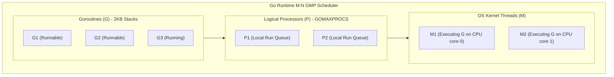

# Goroutines

## Learning objective

Spawn concurrent work with the `go` keyword, reason about goroutine scheduling and lifecycle, and control parallelism with `GOMAXPROCS`.

## Why this matters

Every Go program that handles multiple clients, processes streams, or performs background work uses goroutines. An HTTP server creates one goroutine per incoming request. A CLI tool that fetches data from three APIs concurrently cuts wall-clock time from the sum of latencies to the maximum latency. Goroutines are Go's answer to the question: "How do I do many things at once without the overhead of OS threads?" Mastering goroutines is prerequisite to every other concurrency topic.

## Mental model

A goroutine is a independently executing function that shares the same address space as its creator. Think of your program as a kitchen: the `main` function is the head chef following a recipe. When the head chef says `go peelPotatoes()`, a line cook peels potatoes in parallel while the head chef continues to the next step. Both chefs share the same kitchen (memory) and must coordinate access to shared tools (data structures).

Goroutines are multiplexed onto OS threads automatically. The Go scheduler decides which goroutine runs on which thread at any moment. From your perspective, every goroutine runs concurrently; from the hardware perspective, `GOMAXPROCS` goroutines run in parallel.

## Visual model



## Core idea

The `go` keyword before a function call creates a new goroutine:

```go
go fn()
go func() { /* closure */ }()
```

The caller returns immediately. The new goroutine executes `fn` in its own stack. The function's return value (if any) is discarded — you cannot `result := go fn()`. Communication happens through channels or shared memory with synchronization.

Goroutines are not OS threads:

| Property | OS thread | Goroutine |
|---|---|---|
| Initial stack | ~1 MB | ~2 KB (grows as needed) |
| Create/teardown | Expensive (syscall) | Cheap (userspace) |
| Scheduling | Kernel | Go runtime (M:N scheduler) |
| Context switch | ~1 µs | ~100 ns |
| Max on typical server | Thousands | Millions |

## Under the hood

A goroutine is a `g` struct in the Go runtime. It holds a small stack (initially 2 KB), an instruction pointer, and metadata. When you write `go fn()`, the compiler inserts a call to `runtime.newproc`. This:

1. Allocates a `g` struct on the heap.
2. Copies the function's arguments from the caller's stack to the new goroutine's stack.
3. Enqueues the `g` onto the current `P`'s local run queue.

The Go scheduler runs in user space. It implements an M:N model: `M` OS threads (machines) execute `P` logical processors, which schedule `G` goroutines. Each `P` has a local run queue. When a goroutine makes a blocking call (I/O, channel send/receive, `time.Sleep`, `sync.Mutex`), the `M` is released to pick up another goroutine from the `P`'s queue or from other `P`s (work stealing).

Since Go 1.14, the scheduler is **asynchronously preemptive**: a goroutine that runs too long without a function call (e.g., a tight loop) is preempted by a signal (`SIGURG`), forcing a scheduler decision. Before async preemption, a tight loop could starve other goroutines indefinitely.

## How Go uses it

- **HTTP servers**: `net/http` creates a goroutine per accepted connection via `go c.serve()`.
- **Concurrent API calls**: fan-out requests to multiple services with `go` and collect results.
- **Background workers**: periodic tasks like log rotation, cache warming, or metric aggregation.
- **`go test`**: subtests can run in parallel with `t.Parallel()`, which uses goroutines under the hood.
- **Finalizers and GC**: the runtime uses internal goroutines for `runtime.GC()` and `runtime/trace`.

## Go example

```go
package main

import (
	"fmt"
	"runtime"
	"sync"
	"time"
)

func printNumbers(wg *sync.WaitGroup) {
	defer wg.Done()
	for i := 1; i <= 5; i++ {
		time.Sleep(10 * time.Millisecond)
		fmt.Printf("goroutine: %d\n", i)
	}
}

func sayHello() {
	fmt.Println("Hello from a goroutine")
}

func main() {
	fmt.Println("=== Goroutine basics ===")
	go sayHello()
	time.Sleep(50 * time.Millisecond)

	fmt.Println("\n=== Goroutine scheduling ===")
	var wg sync.WaitGroup
	wg.Add(2)

	go func() {
		defer wg.Done()
		for i := 0; i < 3; i++ {
			runtime.Gosched()
			fmt.Println("lambda goroutine")
		}
	}()

	go printNumbers(&wg)
	wg.Wait()

	fmt.Println("\n=== GOMAXPROCS ===")
	fmt.Printf("Logical CPUs: %d\n", runtime.NumCPU())
	fmt.Printf("GOMAXPROCS: %d\n", runtime.GOMAXPROCS(0))

	fmt.Println("\n=== Goroutine stack growth ===")
	stackTester(0)
}

func stackTester(depth int) {
	if depth >= 1000 {
		return
	}
	if depth%100 == 0 {
		fmt.Printf("stack depth: %d\n", depth)
	}
	stackTester(depth + 1)
}
```

Expected output (the interleaving varies between runs; `Logical CPUs` and `GOMAXPROCS` depend on the machine):

```
=== Goroutine basics ===
Hello from a goroutine

=== Goroutine scheduling ===
lambda goroutine
lambda goroutine
lambda goroutine
goroutine: 1
goroutine: 2
goroutine: 3
goroutine: 4
goroutine: 5

=== GOMAXPROCS ===
Logical CPUs: 12
GOMAXPROCS: 12

=== Goroutine stack growth ===
stack depth: 0
stack depth: 100
stack depth: 200
stack depth: 300
stack depth: 400
stack depth: 500
stack depth: 600
stack depth: 700
stack depth: 800
stack depth: 900
```

## Step-by-step execution

The program has four sections. Each one isolates a property of goroutines.

1. **Basics.** `main` starts `sayHello` with `go`. The `go` statement enqueues the new goroutine and returns immediately, so `main` continues to `time.Sleep(50 * time.Millisecond)`. During that sleep the scheduler runs `sayHello`, which prints `Hello from a goroutine`. Without the sleep, `main` could exit before `sayHello` runs.
2. **Scheduling.** `wg.Add(2)` reserves two slots before either goroutine starts. The first goroutine calls `runtime.Gosched()` on every iteration, which voluntarily yields its processor to the run queue. The second goroutine, `printNumbers`, sleeps 10 ms between prints. The two interleave because both yield: `Gosched` yields cooperatively, and `time.Sleep` parks the goroutine until the timer fires. `wg.Wait()` blocks `main` until both call `wg.Done()`.
3. **GOMAXPROCS.** `runtime.NumCPU()` returns the logical CPU count. `runtime.GOMAXPROCS(0)` returns the current setting without changing it, which defaults to that CPU count. `GOMAXPROCS` caps how many goroutines run Go code in parallel; it does not cap how many goroutines exist.
4. **Stack growth.** `stackTester` recurses 1000 frames, printing every 100th depth. Each frame grows the goroutine stack; the runtime copies the stack to a larger allocation when it fills. This is why a goroutine can start at 2 KB and serve a deep call chain without a fixed large stack.

The print order in the scheduling section is non-deterministic because the scheduler interleaves runnable goroutines at every yield point.

## Runtime evidence

Run the lesson tests with the race detector:

```bash
go test -race -count=1 .
```

Expected output (from `curriculum/modules/11-lifecycle-context-concurrency/lessons/11-goroutines`):

```text
ok  	github.com/rasel9t6/the-go-engineer/curriculum/modules/11-lifecycle-context-concurrency/lessons/11-goroutines	0.4s
```

The race detector instruments every memory access. The example passes because `sync.WaitGroup` establishes a happens-before edge between each goroutine and `wg.Wait()`; no unsynchronized shared memory remains.

To observe the scheduler directly, build the binary and enable the scheduler trace:

```bash
go build -o goroutines-demo .
GODEBUG=schedtrace=1000 ./goroutines-demo
```

Expected output (the first line is the scheduler snapshot, printed to stderr; the program output follows):

```text
SCHED 0ms: gomaxprocs=12 idleprocs=12 threads=6 spinningthreads=0 needspinning=0 idlethreads=3 runqueue=0 [ 0 0 0 0 0 0 0 0 0 0 0 0 ] schedticks=[ 3 0 0 0 0 0 0 0 0 0 2 2 ]
```

Interpretation: `schedtrace=1000` prints a scheduler snapshot every 1000 ms. `gomaxprocs=12` is the number of logical processors (P) the runtime created, equal to `runtime.NumCPU()` on this machine. `idleprocs=12` means every P was idle at that instant, which is expected for a short-lived program. `threads=6` is the count of OS threads (M) currently created. `runqueue=0` and the twelve `[ 0 ... ]` entries are the per-P local run queue lengths. Your machine reports different numbers; the invariant is that `gomaxprocs` equals `runtime.NumCPU()` unless you override it.

Now force a single processor and rerun:

```bash
GOMAXPROCS=1 GODEBUG=schedtrace=1000 ./goroutines-demo
```

Expected output:

```text
SCHED 0ms: gomaxprocs=1 idleprocs=1 threads=4 spinningthreads=0 needspinning=0 idlethreads=1 runqueue=0 [ 0 ] schedticks=[ 6 ]
```

Interpretation: `gomaxprocs=1` and a single-element `runqueue` array show that one P now services every goroutine. All goroutines still run, but they cannot execute Go code in parallel. This is the difference between concurrency (all goroutines make progress) and parallelism (multiple goroutines run at the same instant).

## Common mistakes

- **No synchronization**: starting a goroutine and exiting `main` before it runs. The program exits when `main` returns; pending goroutines are terminated.
  - Fix: use `sync.WaitGroup` or channels to coordinate.
- **`GOMAXPROCS` misunderstanding**: `GOMAXPROCS` limits parallel execution of Go code, not total goroutines. 100 goroutines with `GOMAXPROCS=1` still run concurrently (interleaved on one thread).
- **Assuming goroutines start instantly**: the `go` statement enqueues the goroutine; it may not run until the next scheduler point.
- **Starving other goroutines**: a tight loop without function calls blocks the P. If `GOMAXPROCS=1`, no other goroutine runs until the loop yields.
  - Fix: insert `runtime.Gosched()` in tight loops to voluntarily yield.
- **Capturing loop variables**: `for i := 0; i < 5; i++ { go func() { fmt.Println(i) }() }` — all goroutines see the final `i` value.
  - Fix: `go func(n int) { fmt.Println(n) }(i)`.

## Debugging walkthrough

Consider this program that exits prematurely:

```go
package main

import (
	"fmt"
	"time"
)

func main() {
	go func() {
		fmt.Println("background work")
	}()
	fmt.Println("main done")
}
```

**Symptom**: sometimes "background work" does not print.

**Investigation**: add a `time.Sleep` to confirm the goroutine runs. Then check whether the issue is timing or never started.

**Root cause**: `main` returns before the goroutine is scheduled. The program exits.

**Fix 1 — WaitGroup**:

```go
var wg sync.WaitGroup
wg.Add(1)
go func() {
	defer wg.Done()
	fmt.Println("background work")
}()
wg.Wait()
```

**Fix 2 — channel**:

```go
done := make(chan struct{})
go func() {
	fmt.Println("background work")
	close(done)
}()
<-done
```

## Production notes

- **Goroutine panics**: an unhandled panic in a goroutine crashes the entire process, not just the goroutine. Defer `recover` inside every long-lived goroutine to isolate failures.
- **Connection handling**: every `net/http` connection creates a goroutine. Under load, this means tens of thousands of goroutines. The runtime handles this well, but each goroutine consumes ~2 KB stack + heap overhead for its closure.
- **Graceful shutdown**: use `context.Context` + `sync.WaitGroup` to drain in-flight goroutines before `os.Signal`.
- **Logging**: always include a goroutine identifier (or use `runtime.GoID()` via `runtime.Stack`) in logs during debugging, but never use `runtime.GoID()` in production — it is considered an anti-pattern.
- **Limit creation**: for CPU-bound work, cap active goroutines to `runtime.GOMAXPROCS(0)` to avoid oversubscription.

## Performance implications

| Operation | Approximate cost |
|---|---|
| Goroutine creation | ~200 ns (on modern CPU) |
| Goroutine context switch | ~100 ns (userspace) |
| OS thread context switch | ~1 µs (kernel) |
| Goroutine stack (idle) | ~2 KB |
| OS thread stack (idle) | ~1 MB |

Creating a goroutine is ~5000x cheaper than creating an OS thread. However, goroutines are not free. 1,000,000 goroutines consuming 2 KB each = 2 GB of stack memory before any work. Use bounded worker pools for massive concurrency.

`GOMAXPROCS` greater than `runtime.NumCPU()` can degrade performance due to cache contention and thread switching. The default is `NumCPU`.

## Practice task

Write a program that:

1. Launches 10 goroutines, each printing its ID and sleeping for `ID * 100` milliseconds.
2. Uses `sync.WaitGroup` to wait for all goroutines to finish before `main` exits.
3. Reports the total elapsed time.
4. Prints the current `GOMAXPROCS` value and the number of CPU cores.

Run it and observe the non-deterministic print order. Then set `GOMAXPROCS=1` and compare the output sequence and total time.

## Tests / verification

```bash
go run ./curriculum/modules/11-lifecycle-context-concurrency/lessons/11-goroutines
go test -race -count=1 ./curriculum/modules/11-lifecycle-context-concurrency/lessons/11-goroutines
```

The `go run` command prints the four section banners and the goroutine output. The `go test` command runs the package tests under the race detector; a clean run prints `ok`.

## Review questions

1. What is the initial stack size of a goroutine, and how does it compare to an OS thread?
2. What does `runtime.GOMAXPROCS(0)` return? What happens if you set it to 1 on an 8-core machine?
3. Why can't you capture the return value of `go fn()`? How do you get results from a goroutine?
4. What happens when `main` returns while 3 goroutines are still running?
5. Describe a scenario where creating too many goroutines can harm performance despite each one being "cheap".

## NEXT UP

[Waitgroups](../12-waitgroups/README.md)
