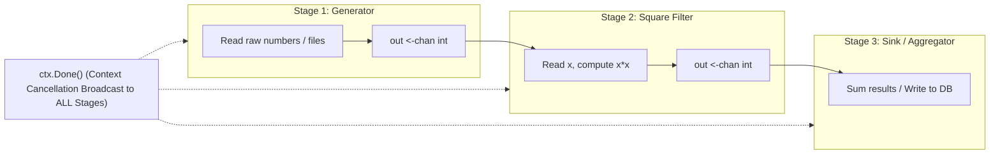

# Pipelines

## Learning objective

Build concurrent pipelines using channels to compose stages, apply fan-out/fan-in for parallelism, and propagate cancellation through the pipeline with context.

## Why this matters

Real-world data processing is a sequence of stages: fetch, transform, enrich, aggregate, store. With channels, each stage is a goroutine connected by typed channels. The result is a composable, testable, and naturally concurrent system. Pipelines are the foundation of stream processing, ETL jobs, log processors, and request middleware chains. Adding or removing a stage is a local change — you insert a new goroutine between two channels — without altering other stages.

## Mental model

A pipeline is an assembly line. Raw material enters at one end (generator), passes through a series of workstations (stages), and exits as a finished product (sink). Each workstation has a worker (goroutine) that takes items from its input belt (channel), processes them, and places them on the output belt (channel).

Fan-out is like adding parallel workstations: multiple workers process items from the same input belt, increasing throughput. Fan-in is like merging several output belts into one: multiple workstations feed into a single final belt.

Cancellation is the emergency stop button: when pulled, every workstation stops processing and the belts clear.

## Visual model



## Core idea

```
generator -> stage1 -> stage2 -> ... -> sink
```

Each stage is defined by its input and output channels:

```go
func stage(name string, in <-chan int) <-chan int {
    out := make(chan int)
    go func() {
        defer close(out)
        for v := range in {
            out <- transform(v)
        }
    }()
    return out
}
```

Fan-out (distribute to N parallel workers):

```go
func fanOut(in <-chan int, n int) []<-chan int {
    outs := make([]<-chan int, n)
    for i := 0; i < n; i++ {
        outs[i] = stage(in) // each stage reads from same in
    }
    return outs
}
```

Fan-in (merge N channels into one):

```go
func fanIn(chs ...<-chan int) <-chan int {
    out := make(chan int)
    var wg sync.WaitGroup
    for _, c := range chs {
        wg.Add(1)
        go func(ch <-chan int) {
            defer wg.Done()
            for v := range ch {
                out <- v
            }
        }(c)
    }
    go func() {
        wg.Wait()
        close(out)
    }()
    return out
}
```

Cancellation propagation: each stage checks `ctx.Done()` in a `select` to abort early.

## Under the hood

A pipeline is not a runtime construct — it is a design pattern using channels and goroutines. Each stage runs in its own goroutine. The stages are connected by channels, which provide:

- **Synchronization**: each send/receive pairs a producer and consumer. The producer blocks when the consumer's buffer is full or the consumer is not ready — this is backpressure.
- **Ownership**: each stage owns its output channel and closes it when done.
- **Cancellation**: when `ctx` is cancelled, `ctx.Done()` returns a closed channel. Each stage's `select` case `<-ctx.Done()` fires, and the stage exits without sending to its output. The output channel is closed in `defer`, which propagates the cancellation downstream.

## How Go uses it

- **Log processing**: a pipeline reads log lines, parses them, enriches with geo-IP, filters by severity, and writes to storage.
- **Image processing**: download, resize, watermark, upload — each stage is a goroutine.
- **ETL jobs**: extract from DB, transform rows, load to warehouse — pipeline stages connected by channels.
- **Request middleware**: HTTP middleware is a pipeline of `http.Handler` stages.
- **CI/CD pipelines**: build, test, deploy stages connected by artifact channels.
- **`io.Pipe`**: `io.PipeReader` and `io.PipeWriter` are a byte-level pipeline.

## Go example

```go
package main

import (
	"context"
	"fmt"
	"sync"
	"time"
)

func generator(ctx context.Context, nums ...int) <-chan int {
	out := make(chan int)
	go func() {
		defer close(out)
		for _, n := range nums {
			select {
			case out <- n:
			case <-ctx.Done():
				return
			}
		}
	}()
	return out
}

func multiply(ctx context.Context, in <-chan int, factor int) <-chan int {
	out := make(chan int)
	go func() {
		defer close(out)
		for n := range in {
			select {
			case out <- n * factor:
			case <-ctx.Done():
				return
			}
		}
	}()
	return out
}

func add(ctx context.Context, in <-chan int, delta int) <-chan int {
	out := make(chan int)
	go func() {
		defer close(out)
		for n := range in {
			select {
			case out <- n + delta:
			case <-ctx.Done():
				return
			}
		}
	}()
	return out
}

func fanOut(ctx context.Context, in <-chan int, n int) []<-chan int {
	outs := make([]<-chan int, n)
	for i := 0; i < n; i++ {
		outs[i] = multiply(ctx, in, i+1)
	}
	return outs
}

func fanIn(ctx context.Context, channels ...<-chan int) <-chan int {
	out := make(chan int)
	var wg sync.WaitGroup
	for _, ch := range channels {
		wg.Add(1)
		go func(c <-chan int) {
			defer wg.Done()
			for n := range c {
				select {
				case out <- n:
				case <-ctx.Done():
					return
				}
			}
		}(ch)
	}
	go func() {
		wg.Wait()
		close(out)
	}()
	return out
}

func main() {
	ctx, cancel := context.WithTimeout(context.Background(), 100*time.Millisecond)
	defer cancel()

	fmt.Println("=== Basic pipeline ===")
	gen := generator(ctx, 1, 2, 3, 4, 5)
	mul := multiply(ctx, gen, 2)
	add2 := add(ctx, mul, 10)

	for v := range add2 {
		fmt.Println(v)
	}
	fmt.Println()

	fmt.Println("=== Fan-out / Fan-in ===")
	gen2 := generator(ctx, 1, 2, 3)
	fanned := fanOut(ctx, gen2, 3)
	merged := fanIn(ctx, fanned...)

	for v := range merged {
		fmt.Printf("merged: %d\n", v)
	}
}
```

## Step-by-step execution

For the pipeline `generator(1..5) -> multiply(factor 2) -> add(delta 10)`:

1. `generator` sends 1. `multiply` receives 1, computes 2, sends 2. `add` receives 2, computes 12. Main receives 12.
2. `generator` sends 2. `multiply` -> 4, `add` -> 14. Main receives 14.
3. Continues for 3, 4, 5. Main receives 16, 18, 20.
4. The generator has only five values, so every stage normally drains and finishes via channel closure: `generator` closes its output after sending five values, each downstream `range` loop ends on that close, and each stage closes its own output via `defer close(out)`. The `ctx.Done()` branches exist for the failure path — if a stage stalls past the 100ms deadline (a slow consumer downstream, an infinite generator), the `select` takes `ctx.Done()` and every goroutine unwinds instead of leaking.

The pipeline processes one item at a time through all stages. Each stage can block if the next is not ready — this is backpressure. The context deadline bounds the whole pipeline, so slow stages cannot hang the process.

## Common mistakes

- **Closing the wrong channel**: each stage must close its output channel. A stage that closes its input channel (which it does not own) causes the upstream stage to panic on send.
  - Fix: never close an input channel. Close only the output channel that the stage owns.
- **Blocking on send without cancellation**: if the downstream stage stops reading, the current stage blocks forever on send.
  - Fix: always include `ctx.Done()` in `select` when sending.
- **Fan-in without WaitGroup**: if the fan-in goroutine closes the output channel before all input channels are exhausted, receivers see premature end of data.
  - Fix: use `sync.WaitGroup` and close in a dedicated goroutine.
- **Fan-out sending duplicates**: multiple goroutines reading from the same channel — each value goes to exactly one reader. This is correct for distributing work, but surprising if you expect broadcast.
  - Fix: for broadcast, create one channel per consumer and send to all.

## Debugging walkthrough

```go
func main() {
    gen := generator(1, 2, 3, 4, 5)
    sq := square(gen)
    for v := range sq {
        time.Sleep(100 * time.Millisecond)
        fmt.Println(v)
    }
}
```

**Symptom**: pipeline works but becomes noticeably slow when any stage is slow.

**Root cause**: each stage processes one item then blocks until the next stage is ready. A slow consumer backs up the entire pipeline.

**Fix**: add buffered channels between stages to decouple:

```go
func square(ctx context.Context, in <-chan int) <-chan int {
    out := make(chan int, 10) // buffer
    ...
}
```

Or use fan-out for CPU-intensive stages.

## Production notes

- **Buffer between stages**: unbuffered channels cause tight coupling. A small buffer (e.g., 10-100) absorbs bursts and increases throughput.
- **Graceful shutdown**: pass a `context.Context` to every stage. On `SIGTERM`, cancel the context. Each stage exits its `select` when `ctx.Done()` fires.
- **Error handling**: a stage that encounters an error should either send an error wrapper or drain its input and exit. Do not panic. Use `errgroup` from `golang.org/x/sync/errgroup` for pipelines where any stage error should cancel all stages.
- **Metrics**: instrument each stage with counters (items in, items out, errors, latency). Use `expvar` or Prometheus.
- **Limited goroutines**: unbounded pipeline depth creates unlimited goroutines (one per stage per pipeline instance). For dynamic pipelines (e.g., per-request), bound the number of concurrent stages.

## Performance implications

| Aspect | Unbuffered | Buffered |
|---|---|---|
| Throughput | Limited by slowest stage | Burst absorption |
| Latency per item | Sum of all stage times | Sum + queuing delay |
| Memory | Minimal | Buffer size × element size |
| Backpressure | Immediate | Delayed by buffer |

Fan-out with N workers can increase throughput up to N× for CPU-bound work, limited by `GOMAXPROCS`. For I/O-bound work, fan-out can exceed GOMAXPROCS because blocked goroutines yield their M.

## Practice task

Build a pipeline that:

1. **Generator**: reads integers from `os.Args` or a hardcoded slice.
2. **Filter**: keeps only even numbers.
3. **Multiply**: multiplies each by 10.
4. **ToJSON**: converts each number to a JSON string `{"value": N}`.
5. **Sink**: prints each JSON string.

Add a `context.WithTimeout` of 2 seconds. If the pipeline does not complete in 2 seconds, cancel and report "timeout". Test with 10, then 1,000,000 inputs (but with a small buffer to avoid OOM).

## Tests / verification

```bash
go run ./curriculum/modules/11-lifecycle-context-concurrency/lessons/18-pipelines
go test ./curriculum/modules/11-lifecycle-context-concurrency/lessons/18-pipelines
```

## Review questions

1. What is the difference between fan-out and fan-in in a pipeline?
2. Why must each stage close its own output channel?
3. How does cancellation propagate through a pipeline?
4. What happens if a stage in the middle of a pipeline panics?
5. How would you add error handling to a pipeline stage?

## NEXT UP

[Mutex And Rwmutex](../19-mutex-and-rwmutex/README.md)
