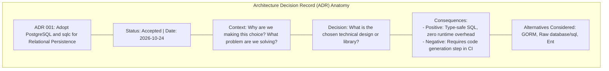

# Architecture decision records

## Learning objective

Write architecture decision records (ADRs) using the standard format, manage the ADR lifecycle from proposal to supersession, document tradeoffs with pros and cons, and implement a Go-based ADR management tool.

## Why this matters

Architecture decisions are the most expensive decisions a software team makes. A wrong database choice or service boundary error costs months of rework. Yet most teams make these decisions in Slack threads, hallway conversations, or meeting notes that are lost within weeks. ADRs capture the context, decision, and consequences in a version-controlled document that lives alongside the code. New team members read ADRs to understand why things are the way they are. Future engineers see that the decision was deliberate, not accidental. Every professional Go engineer should write ADRs for non-trivial architecture decisions.

## Mental model

An ADR is a commit message for an architecture decision. It records what was decided, why, what alternatives were considered, and what the consequences are. Like a commit, an ADR has a lifecycle: it is proposed, accepted, and possibly deprecated or superseded by a later ADR.

Think of ADRs as a decision journal. When you face a fork in the road (monolith vs microservices, PostgreSQL vs MySQL, REST vs gRPC), you write an ADR documenting which path you took and why. Six months later, when someone asks "why did we choose Kafka over RabbitMQ?", the ADR has the answer.

## Visual model



## Core idea

The standard ADR format (by Michael Nygard):

```
# ADR-NNN: Title

## Status
proposed | accepted | deprecated | superseded

## Context
The situation that motivated the decision.
What is the problem being solved?
What constraints exist?

## Decision
The chosen approach. Full sentences, active voice.
"This ADR proposes that we use X because Y."

## Consequences
What becomes easier or harder after this decision?
What tradeoffs were accepted?
```

Optional sections: `Alternatives Considered`, `Pros and Cons`, `Consequences`.

ADR lifecycle:
1. **Proposed**: written by any team member, not yet agreed.
2. **Accepted**: agreed by the team, the decision is in effect.
3. **Deprecated**: no longer recommended but still in use.
4. **Superseded**: replaced by a newer ADR (references the new one).

## Under the hood

ADRs should live in the repository at `docs/adr/` with sequential numbering. Each ADR is a markdown file: `docs/adr/ADR-001-use-postgresql.md`. The sequence number must never be reused, even if an ADR is deprecated.

The ADR number is permanent. It becomes a stable reference in code comments, pull request descriptions, and team discussions. When an ADR is superseded, the old ADR includes a `Superseded by ADR-NNN` line in its status, and the new ADR includes a `Supersedes ADR-MMM` line.

ADR review process:
1. Author writes the ADR under `docs/adr/` in a branch.
2. Team reviews in a pull request.
3. Discussion happens in PR comments (which are also documented).
4. When consensus is reached, the PR merges and the ADR becomes accepted.
5. If no consensus, the ADR is not merged or is marked as rejected (a valid state).

## How Go uses it

- **Kubernetes**: the Kubernetes project uses ADRs (called "KEPs" -- Kubernetes Enhancement Proposals) for every significant architecture change.
- **Go standard library**: the Go proposal process (`golang.org/issue`) serves a similar purpose. Proposals include motivation, design, and alternatives.
- **`docs/adr/` directory**: GitHub and GitLab render markdown files automatically, making ADRs discoverable in the repository browser.
- **`adr-tools`**: a command-line tool (written in Bash) for creating and managing ADRs. Several Go reimplementations exist.

## Go example

```go
package main

import (
	"fmt"
	"time"
)

type ADRStatus string

const (
	StatusProposed   ADRStatus = "proposed"
	StatusAccepted   ADRStatus = "accepted"
	StatusDeprecated ADRStatus = "deprecated"
	StatusSuperseded ADRStatus = "superseded"
)

type ArchitectureDecisionRecord struct {
	ID           string
	Title        string
	Status       ADRStatus
	Context      string
	Decision     string
	Consequences string
	Alternatives []string
	Pros         []string
	Cons         []string
	Date         time.Time
	Supersedes   string
}

func NewADR(id, title string) *ArchitectureDecisionRecord {
	return &ArchitectureDecisionRecord{
		ID:     id,
		Title:  title,
		Status: StatusProposed,
		Date:   time.Now(),
	}
}

func (a *ArchitectureDecisionRecord) Accept() {
	a.Status = StatusAccepted
}

func (a *ArchitectureDecisionRecord) Deprecate() {
	a.Status = StatusDeprecated
}

func (a *ArchitectureDecisionRecord) Supersede(newID string) {
	a.Status = StatusSuperseded
	a.Supersedes = newID
}

func (a *ArchitectureDecisionRecord) String() string {
	result := fmt.Sprintf("# %s - %s\n", a.ID, a.Title)
	result += fmt.Sprintf("Status: %s\n", a.Status)
	result += fmt.Sprintf("Date: %s\n\n", a.Date.Format("2006-01-02"))
	result += fmt.Sprintf("## Context\n%s\n\n", a.Context)
	result += fmt.Sprintf("## Decision\n%s\n\n", a.Decision)
	result += fmt.Sprintf("## Consequences\n%s\n\n", a.Consequences)
	if len(a.Alternatives) > 0 {
		result += "## Alternatives Considered\n"
		for _, alt := range a.Alternatives {
			result += fmt.Sprintf("- %s\n", alt)
		}
		result += "\n"
	}
	return result
}

type ADRManager struct {
	records map[string]*ArchitectureDecisionRecord
}

func NewADRManager() *ADRManager {
	return &ADRManager{records: make(map[string]*ArchitectureDecisionRecord)}
}

func (m *ADRManager) Add(adr *ArchitectureDecisionRecord) {
	m.records[adr.ID] = adr
}

func (m *ADRManager) Get(id string) *ArchitectureDecisionRecord {
	return m.records[id]
}

func (m *ADRManager) ByStatus(status ADRStatus) []*ArchitectureDecisionRecord {
	var result []*ArchitectureDecisionRecord
	for _, r := range m.records {
		if r.Status == status {
			result = append(result, r)
		}
	}
	return result
}

func (m *ADRManager) All() []*ArchitectureDecisionRecord {
	result := make([]*ArchitectureDecisionRecord, 0, len(m.records))
	for _, r := range m.records {
		result = append(result, r)
	}
	return result
}

func main() {
	manager := NewADRManager()

	adr1 := NewADR("ADR-001", "Use PostgreSQL for Primary Database")
	adr1.Context = "The team needs a primary database for the new order management system."
	adr1.Decision = "We will use PostgreSQL 16 as the primary database for all transactional workloads."
	adr1.Consequences = "PostgreSQL provides ACID compliance, full-text search, and JSONB support. The team has existing PostgreSQL expertise. We will use pgx as the Go driver."
	adr1.Alternatives = []string{"MySQL 8 - similar ACID compliance but weaker JSON support", "MongoDB - better scalability but eventual consistency is not suitable for payments", "SQLite - unsuitable for concurrent write workloads"}
	adr1.Accept()
	manager.Add(adr1)

	adr2 := NewADR("ADR-002", "Use Redis for Session Cache")
	adr2.Context = "The authentication service needs a fast, distributed cache for session tokens."
	adr2.Decision = "We will use Redis 7 with TTL-based key expiry. Session data is stored for 24 hours."
	adr2.Consequences = "Redis adds an operational dependency and requires a high-availability configuration with sentinel or cluster mode."
	adr2.Alternatives = []string{"In-memory Go map - not distributed, lost on restart", "Memcached - simpler but no data structures or TTL", "PostgreSQL - too slow for sub-millisecond session lookups"}
	adr2.Accept()
	manager.Add(adr2)

	adr3 := NewADR("ADR-003", "Use Kafka for Event Streaming")
	adr3.Context = "The order service needs to publish events for downstream consumers."
	adr3.Decision = "We will use Apache Kafka with Avro serialization and Schema Registry."
	adr3.Consequences = "Kafka provides at-least-once delivery guarantee. Consumers must be idempotent. Avro provides schema evolution."
	adr3.Alternatives = []string{"RabbitMQ - better for task queues, not event streaming", "AWS SQS - simpler but no ordered consumption", "gRPC streaming - no persistence or replay"}
	adr3.Accept()
	manager.Add(adr3)

	adr4 := NewADR("ADR-004", "Monolith First, Extract Services Later")
	adr4.Context = "The team is considering microservices architecture for the new platform."
	adr4.Decision = "We will start with a well-factored monolith. Services will only be extracted when the monolith causes measurable deployment pain."
	adr4.Consequences = "This avoids premature distributed complexity. We must enforce strict package boundaries within the monolith to make future extraction easier."
	adr4.Alternatives = []string{"Immediate microservices - adds overhead with no proven need", "Serverless - vendor lock-in and cold start latency"}
	adr4.Accept()
	manager.Add(adr4)

	for _, adr := range manager.All() {
		fmt.Println(adr.String())
	}

	fmt.Println("--- Accepted ADRs ---")
	for _, adr := range manager.ByStatus(StatusAccepted) {
		fmt.Printf("- %s: %s\n", adr.ID, adr.Title)
	}
}
```

## Step-by-step execution

For creating ADR-001:

1. `NewADR("ADR-001", "Use PostgreSQL")` creates an ADR with Proposed status and current date.
2. Set `Context`, `Decision`, `Consequences`, `Alternatives`.
3. `adr1.Accept()` sets Status to Accepted.
4. `m.Add(adr1)` stores it in the manager's map.
5. `m.Get("ADR-001")` retrieves the ADR.
6. `m.ByStatus(Accepted)` returns all accepted ADRs including ADR-001.

For ADR lifecycle:
1. ADR-001 is proposed → accepted (after team review).
2. ADR-001 is later deprecated when the team migrates to a new database.
3. ADR-004 (Use CockroachDB) supersedes ADR-001: `adr1.SupersedeBy("ADR-004")`.

## Common mistakes

- **Writing ADRs after the decision is made**: an ADR should be written as part of the decision process, not as post-hoc documentation. The alternatives and tradeoffs are fresh only during the decision.
- **Too much detail**: ADRs are not design documents. Keep them to 1-2 pages. The goal is to capture the rationale, not the full implementation spec.
- **No alternatives section**: listing "alternatives considered" shows the team explored options. A reader in the future who disagrees with the decision can understand what was ruled out and why.
- **Skipping consequences**: every decision has downsides. Documenting them helps future engineers decide whether to revisit the decision.
- **Not updating ADRs**: when a decision is reversed or superseded, update the ADR status. A stale ADR with "accepted" status that no longer applies is misleading.

## Debugging walkthrough

A new engineer asks: "Why are we using RabbitMQ instead of Kafka?"

**Symptom**: No one on the team remembers the rationale. The decision was made 2 years ago.

**Investigation**: Check `docs/adr/`. Find `ADR-007-use-rabbitmq.md`.

The ADR says:
```
Status: accepted

Context: The order service needs to publish events to 2 downstream consumers.
Throughput is 100 msg/s. We do not need event replay or long-term retention.

Decision: Use RabbitMQ for event publishing.

Alternatives:
- Kafka: overkill for 100 msg/s, operational complexity is too high for a 3-person team.
- Redis Pub/Sub: no persistence, messages lost on crash.
```

**Root cause**: There was no ADR. The decision was made in a Slack message. The team does not practice ADR documentation.

**Fix**: Start writing ADRs. Write `ADR-001-use-adrs.md` as the first ADR to formalize the practice. Write ADRs for the last 3 significant architecture decisions retroactively (with context from the Slack history).

## Production notes

- **ADR template**: create a `docs/adr/template.md` with the standard sections. Everyone starts from the same template.
- **ADR review in PRs**: require an ADR (or reference to an existing ADR) in every pull request that makes an architecture- or infrastructure-level change.
- **Numbering**: use sequential numbering (ADR-001, ADR-002). Do not use dates or feature names -- the number is a stable identifier.
- **Supersession chain**: ADR-001 can be superseded by ADR-005. Keep the chain intact: ADR-001 links to ADR-005, and ADR-005 links back to ADR-001.
- **ADR expiry**: periodically review all accepted ADRs. Are they still valid? If not, mark them as deprecated and write a new ADR.

## Performance implications

- **Storage**: ADRs are markdown text files. Storage cost is negligible.
- **Review time**: an ADR review takes 15-30 minutes of team time. This is an investment that pays for itself when it prevents a bad architecture decision.
- **Discovery cost**: finding ADRs in `docs/adr/` is instant. Finding the same information in a wiki, a Notion page, or a Slack message takes 10-60 minutes.
- **Onboarding time**: a new engineer reading 10 ADRs (30 minutes of reading) understands the key architecture decisions of a 5-year-old codebase. Without ADRs, this understanding takes weeks of mentorship and code archaeology.

## Practice task

Write an ADR for a decision you have faced recently (real or hypothetical). Use the standard format with Status, Context, Decision, Consequences, and Alternatives Considered. Then implement a Go function `RenderADR(adr *ADR) string` that returns the ADR as a formatted markdown string.

## Tests / verification

```bash
go run ./curriculum/modules/14-architecture-distributed-systems/lessons/17-architecture-decision-records
go test ./curriculum/modules/14-architecture-distributed-systems/lessons/17-architecture-decision-records
```

The tests verify ADR creation, status transitions (proposed, accepted, deprecated, superseded), manager CRUD operations, and filtering by status.

## Review questions

1. What are the four ADR lifecycle states, and when is each used?
2. Why should ADRs be stored in the repository rather than in a wiki or Notion?
3. What is the purpose of the `Alternatives Considered` section in an ADR?
4. How do you handle a situation where an accepted ADR is no longer the right decision?
5. Why is the ADR number permanent even after the ADR is deprecated?

## NEXT UP

Congratulations on completing Module 14! You now understand architecture patterns, distributed systems, event-driven design, multi-tenancy, and architecture decision records. Next up: [Linux Processes](../../../15-docker-cicd-deployment/lessons/01-linux-processes/README.md)
