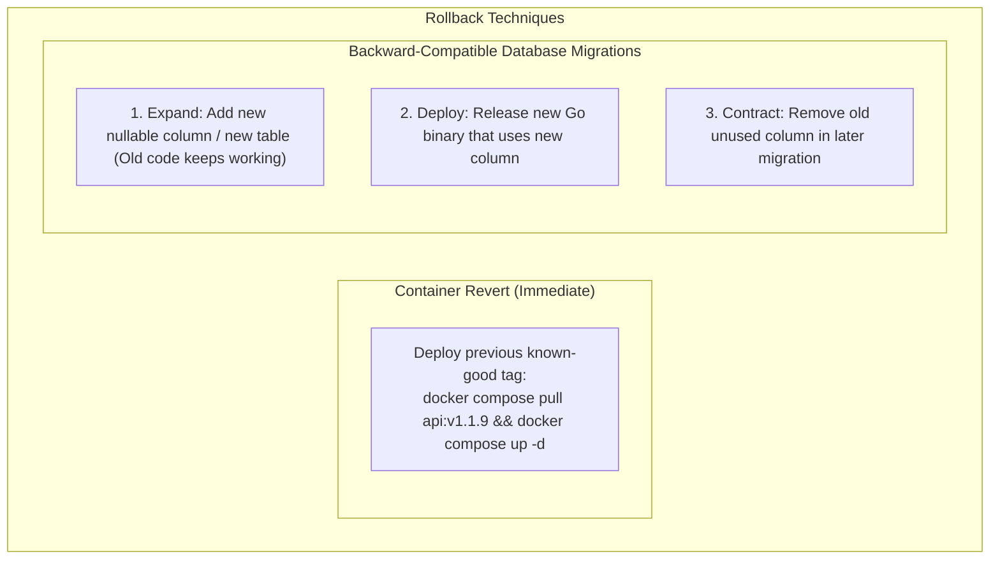

# Rollback basics

## Learning objective

Design and implement rollback plans for deployment failures in Go, model different rollback reasons (error rate, latency, health checks, database issues), and build automated rollback decision logic.

## Why this matters

Every deployment carries risk. Even with thorough testing and canary analysis, a bad deployment can reach production. The difference between a minor incident and a major outage is how quickly you can rollback. A manual rollback with no plan takes 15-60 minutes as engineers scramble to remember the steps. An automated rollback with a tested plan takes under 2 minutes. For Go services running in production, rollback is not optional — it is the safety net that lets you deploy with confidence.

## Mental model

A rollback is the process of reverting a deployment to the previous known-good version. Think of it as an undo button for deployments. The faster and more reliable the undo, the safer it is to deploy frequently.

Rollback is not just redeploying old code. It may involve:

- Switching load balancer traffic back.
- Redeploying the previous binary.
- Reversing database migrations.
- Restoring cached data.
- Notifying users of degraded service.

The rollback plan answers: what do we do, in what order, how long will it take, and what data might we lose?

## Visual model



## Core idea

Rollback strategies by deployment type:

| Deployment type | Rollback method | Speed | Data risk |
|---|---|---|---|
| Blue-green | Switch load balancer back | Seconds | None |
| Canary | Redirect 100% traffic back | Seconds | None |
| Rolling | Redeploy previous version per instance | Minutes | None |
| Recreate | Redeploy from previous artifact | Minutes | None |
| Database migration | Run down migration | Minutes | Possible data loss |

Automated rollback criteria:

| Metric | Threshold | Action |
|---|---|---|
| Error rate | > 1% increase from baseline | Full rollback |
| p99 latency | > 100ms increase from baseline | Full rollback |
| Health check | Any instance fails | Stop deploy, rollback |
| Database errors | Connection failures, migration errors | Rollback app + DB |

## Under the hood

When a rollback is triggered, the deployment system:

1. **Freezes the new deployment**: No more traffic is sent to the new version.
2. **Restores the previous version**: For blue-green, this is a load balancer switch. For rolling, this means redeploying the old binary.
3. **Drains connections**: Existing connections to the failed version complete gracefully (connection draining).
4. **Verifies health**: The restored version must pass health checks.
5. **Notifies**: The team is alerted that a rollback occurred and an incident has been created.

Database rollback is the most complex case. A database migration that removes a column cannot be reversed without data loss if new data was written. The safest approach is additive migrations only: add columns and tables but never remove them. This allows the old code to run with the new schema.

## How Go uses it

Go services implement rollback support at the application level:

- **Graceful shutdown**: Handle SIGTERM to drain in-flight requests before terminating.
- **Readiness probes**: Return 200 only when the server can accept traffic. If startup fails, the orchestrator never routes traffic.
- **Version endpoint**: `GET /version` returns the current binary version. After rollback, the version endpoint confirms the old version is serving traffic.
- **Health aggregation**: A `/health` endpoint that checks database connectivity, cache connectivity, and internal state. If it returns 500, the orchestrator marks the instance as unhealthy.

## Go example

```go
package main

import (
	"fmt"
	"time"
)

type RollbackReason string

const (
	ReasonHighErrorRate   RollbackReason = "high_error_rate"
	ReasonLatencySpike    RollbackReason = "latency_spike"
	ReasonHealthCheckFail RollbackReason = "health_check_failure"
	ReasonManual          RollbackReason = "manual_trigger"
	ReasonDatabaseIssue   RollbackReason = "database_issue"
)

type RollbackPlan struct {
	Version       string
	Reason        RollbackReason
	Steps         []string
	EstimatedTime time.Duration
	DataLossRisk  bool
}

type DeploymentState struct {
	CurrentVersion  string
	PreviousVersion string
	Healthy         bool
	ErrorRate       float64
	FailedDeploy    bool
}

func NewRollbackPlan(prevVersion string, reason RollbackReason) *RollbackPlan {
	plan := &RollbackPlan{
		Version:       prevVersion,
		Reason:        reason,
		EstimatedTime: 3 * time.Minute,
		DataLossRisk:  false,
	}
	switch reason {
	case ReasonHighErrorRate:
		plan.EstimatedTime = 2 * time.Minute
		plan.Steps = []string{
			"Revert load balancer traffic to previous version",
			"Scale down new version instances to zero",
			"Verify error rate returns to baseline",
			"Post-mortem: investigate root cause of errors",
		}
	case ReasonLatencySpike:
		plan.EstimatedTime = 5 * time.Minute
		plan.Steps = []string{
			"Gradually shift traffic back to previous version",
			"Run performance comparison between old and new",
			"Profile new version for slow code paths",
		}
	case ReasonHealthCheckFail:
		plan.EstimatedTime = 1 * time.Minute
		plan.Steps = []string{
			"Stop deploy: new instances never passed health checks",
			"Revert load balancer to old target group",
			"Check new version startup logs for errors",
		}
	case ReasonDatabaseIssue:
		plan.EstimatedTime = 15 * time.Minute
		plan.Steps = []string{
			"Revert application code to previous version",
			"Run database rollback migration (if applicable)",
			"Verify data integrity",
			"Scale down new version instances",
		}
		if reason == ReasonDatabaseIssue {
			plan.DataLossRisk = true
		}
	default:
		plan.Steps = []string{
			fmt.Sprintf("Redeploy version %s", prevVersion),
			"Verify health checks pass",
			"Monitor for 5 minutes post-rollback",
		}
	}
	return plan
}

func ShouldRollback(state DeploymentState, thresholdErrorRate float64, thresholdLatencyMs float64) (bool, RollbackReason) {
	if !state.Healthy {
		return true, ReasonHealthCheckFail
	}
	if state.FailedDeploy {
		return true, ReasonManual
	}
	return false, ""
}

type RollbackAutomation struct {
	State      DeploymentState
	Thresholds struct {
		ErrorRate    float64
		LatencyRatio float64
	}
}

func (ra *RollbackAutomation) Evaluate() (*RollbackPlan, bool) {
	shouldRollback, reason := ShouldRollback(ra.State, ra.Thresholds.ErrorRate, ra.Thresholds.LatencyRatio)
	if !shouldRollback {
		return nil, false
	}
	plan := NewRollbackPlan(ra.State.PreviousVersion, reason)
	return plan, true
}

func main() {
	fmt.Println("=== Rollback Basics ===")
	fmt.Println()

	state := DeploymentState{
		CurrentVersion:  "v2.0.0",
		PreviousVersion: "v1.0.0",
		Healthy:         false,
		ErrorRate:       0.15,
	}

	shouldRollback, reason := ShouldRollback(state, 0.05, 500)
	if shouldRollback {
		rp := NewRollbackPlan(state.PreviousVersion, reason)
		fmt.Printf("Rollback triggered: %s\n", rp.Reason)
		fmt.Printf("Estimated time: %s\n", rp.EstimatedTime)
		fmt.Printf("Data loss risk: %v\n", rp.DataLossRisk)
		fmt.Println("Steps:")
		for _, s := range rp.Steps {
			fmt.Printf("  - %s\n", s)
		}
	} else {
		fmt.Println("No rollback needed")
	}

	fmt.Println()
	ra := &RollbackAutomation{
		State: DeploymentState{
			CurrentVersion:  "v2.0.0",
			PreviousVersion: "v1.0.0",
			Healthy:         true,
			FailedDeploy:    true,
		},
	}
	rap, ok := ra.Evaluate()
	if ok {
		fmt.Printf("Automation rolled back: %s (reason: %s)\n", rap.Version, rap.Reason)
	} else {
		fmt.Println("Automation: no rollback needed")
	}
}
```

## Step-by-step execution

For a rollback triggered by health check failure:

1. `DeploymentState` has `Healthy: false` — the new version failed health checks.
2. `ShouldRollback` returns `(true, ReasonHealthCheckFail)`.
3. `NewRollbackPlan("v1.0.0", ReasonHealthCheckFail)` creates a plan:
   - `EstimatedTime = 1 minute` (health check rollback is fastest).
   - `DataLossRisk = false` (no data was written because traffic never switched).
4. Steps: stop deploy, revert load balancer, check logs.

For a database issue rollback:

1. Reason is `ReasonDatabaseIssue`.
2. `EstimatedTime = 15 minutes` (database rollback takes longer).
3. `DataLossRisk = true` (data written between migration and rollback may be lost).
4. Steps include reverting application code and running down migration.

## Common mistakes

- **No automated rollback trigger**: Relying on humans to notice a problem and manually trigger rollback adds minutes to incident response time. Automate the decision.
- **Rolling back without verifying**: After switching traffic back, verify health checks pass. The old version might also be unhealthy for a different reason (e.g., expired TLS certificate).
- **Forgetting database rollback**: If the deployment included a database migration, rolling back the code without the database leaves the system in an inconsistent state.
- **Slow rollback due to artifact download**: If the previous artifact is not cached locally, downloading it can take minutes. Keep the previous artifact on each instance or in a local registry.
- **Rollback during traffic peak**: Rolling back during peak traffic can cause a thundering herd on the old instances. Coordinate rollback with a load balancer drain.

## Debugging walkthrough

Consider a deployment that triggered an automated rollback, but the system is still unhealthy.

**Symptom**: After rollback to v1.0.0, error rate is still elevated.

**Investigation**:
1. Check the version endpoint: `curl /version` should return `v1.0.0`. If it returns `v2.0.0`, the rollback did not complete.
2. Check load balancer target groups: is traffic going to the right group?
3. Check v1.0.0 logs for errors. The issue might be unrelated to version: expired database credentials, upstream service outage, or DNS resolution failure.

**Root cause**: The rollback switched traffic, but v1.0.0 was never actually unhealthy. The health check failure was caused by a transient database connection pool exhaustion that affected both versions.

**Fix**: The health check should distinguish between fatal errors (code crash) and transient errors (database timeout). A transient error should not trigger rollback; it should trigger retry.

Another scenario: Rollback to v1.0.0 works, but new feature data written to the database during the v2.0.0 deployment is now orphaned.

**Root cause**: v2.0.0 wrote new columns that v1.0.0 ignores. The rollback migration (removing the column) dropped the data.

**Fix**: Database migrations should be additive and backward-compatible. Never remove a column in the same deployment as code that uses it. Separate schema changes across deployments.

## Production notes

In production rollback systems:

- **Keep N previous artifacts**: Store the last 3-5 release artifacts in a local cache or artifact registry. Rollback to any of them, not just the immediate previous version.
- **Database rollback as code**: Write down migrations that can be reversed. Test the rollback migration in staging before every release.
- **Rollback drill**: Test rollback procedure quarterly. A rollback that has never been tested will fail when needed.
- **Post-rollback incident review**: Every rollback should be analyzed: what went wrong, why was it not caught in CI/staging, and how can we prevent it from happening again?

## Performance implications

- **Load balancer switch is instant**: Changing a target group weight takes under 1 second. This is the fastest rollback mechanism.
- **Redeploying previous version takes as long as a normal deploy**: If startup takes 30 seconds, a rolling rollback of 10 instances takes 5 minutes.
- **Database rollback can be slow**: A down migration that affects millions of rows can take 30+ minutes. Monitor progress and have a manual escalation path.
- **Connection draining adds latency**: During drain, existing connections are allowed to finish (typically 30-300 seconds). Long-lived connections (WebSocket, gRPC streams) may need special handling.

## Practice task

Write a function `CreateRollbackScript(plan *RollbackPlan) string` that generates a shell script (as a string) for executing the rollback plan. Each step should be a comment followed by a sample command. Then write an `ExecutePlan(plan *RollbackPlan) (bool, error)` function that validates that all steps are non-empty and returns true. Write a `main()` that creates a rollback plan for each reason type and prints the script.

## Tests / verification

```bash
go run ./curriculum/modules/15-docker-cicd-deployment/lessons/18-rollback-basics
go test ./curriculum/modules/15-docker-cicd-deployment/lessons/18-rollback-basics
```

The existing tests verify rollback plan creation for every reason type, step count and content, rollback decision logic (healthy, unhealthy, failed deploy), automation evaluation, time estimates, and data loss risk flags. After completing the practice task, add tests for `CreateRollbackScript` and `ExecutePlan`.

## Review questions

1. Why is automated rollback important? What happens when rollback depends on a human noticing an issue?
2. What is the fastest rollback method? What deployment strategy enables it?
3. Why are database rollbacks riskier than application rollbacks? What is the recommended approach to reduce this risk?
4. After a rollback, what verification steps should be performed to confirm the system is healthy?
5. A deployment passes health checks but error rate increases 5 minutes later. How would you design the automated rollback detection for this scenario?

## NEXT UP

[Deployment Runbook](../19-deployment-runbook/README.md)
