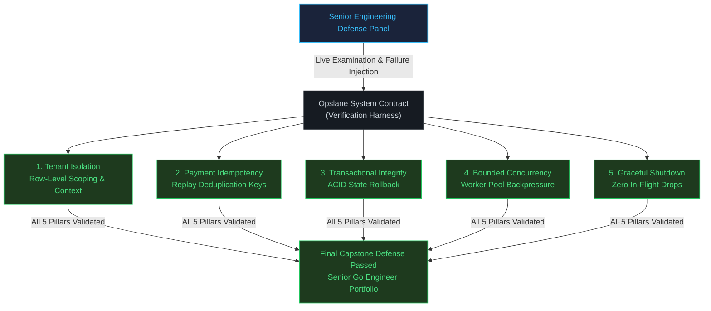

# Opslane portfolio defense

## Mission

Defend the complete Opslane distributed operations platform before a senior engineering review panel, demonstrating architectural reasoning, security boundaries, transactional guarantees, and failure recovery.

## Prerequisites

- `opslane-14`: Deployment health probes and zero-downtime rolling updates.
- Complete Flagship Opslane reference implementation (`projects/opslane-flagship/_solution/main.go`).

## Mental Model

An engineering portfolio defense mirrors an architecture review: building the software proves implementation competence, but defending the architecture proves engineering judgment. The candidate must justify trade-offs, explain failure boundaries, and articulate why alternative designs were rejected.

## Visual Model



## Machine View

Under the hood, the verification contract tracks five non-negotiable operational invariants:
1. **Multi-Tenant Memory & Query Scoping**: All repository reads and in-memory caches scope queries by `tenant_id`. Cross-tenant probes return empty sets or `ErrTenantMismatch`.
2. **Idempotency Key De-duplication**: Network retries with matching idempotency keys return the cached transaction receipt without re-invoking payment gateways or mutating ledger state.
3. **Two-Phase Transactional Rollback**: Inventory reservation and order state transitions execute in an atomic transaction; database errors trigger explicit `Rollback()`, leaving zero orphaned rows.
4. **Bounded Goroutine Allocation**: Tasks route through bounded worker channels; burst traffic triggers backpressure rather than unbounded goroutine creation and OOM panic.
5. **Phased Graceful Draining**: Termination signals reject new ingress, allow active requests to finish within the SLA, and flush background queues before releasing process resources.

A representative excerpt from `main.go` (`OpslaneSystemContract.VerifyIdempotency`):

```go
// VerifyIdempotency ensures second charge with same key returns cached transaction ID without re-executing.
func (c *OpslaneSystemContract) VerifyIdempotency(key string) (txID string, wasCharged bool) {
	c.mu.Lock()
	defer c.mu.Unlock()

	if existingTx, found := c.idemKeys[key]; found {
		c.criteria["idempotency"].Validated = true
		return existingTx, false // Cached replay
	}

	c.chargesRun.Add(1)
	newTx := fmt.Sprintf("tx-%d", c.chargesRun.Load())
	c.idemKeys[key] = newTx

	return newTx, true
}
```

## Run Instructions

```bash
# Run portfolio defense test suite against reference solution
go test -v -race ./curriculum/modules/18-flagship-opslane/projects/15-opslane-portfolio-defense/_solution

# Run defense against your starter implementation
go test -v -race ./curriculum/modules/18-flagship-opslane/projects/15-opslane-portfolio-defense/_starter
```

## Code Walkthrough

1. **Defense Criterion Models (lines 9–14)**: Defines `DefenseCriterion` representing each foundational architectural pillar.
2. **`OpslaneSystemContract` Harness (lines 16–53)**: Tracks criteria validation flags, tenant datasets, idempotency records, and atomic execution counters under `sync.Mutex`.
3. **`VerifyTenantBoundary` (lines 55–71)**: Simulates Tenant B attempting to access Tenant A's private resource; fails verification if cross-tenant leakage occurs.
4. **`VerifyIdempotency` (lines 73–88)**: Validates that first payment invocation executes and charges, while duplicate submissions with identical idempotency keys replay the existing transaction ID without re-executing.
5. **`AllCriteriaValidated` (lines 90–101)**: Confirms that all five architectural criteria have passed inspection.
6. **`main()` (lines 103–111)**: Runs an end-to-end rehearsal of the defense verification harness.

## Try It

1. Run the test suite against `_starter` and observe the failure output.
2. Implement `VerifyTenantBoundary` in `_starter/main.go` and run the tests to verify the tenant isolation pillar passes.
3. Implement `VerifyIdempotency` in `_starter/main.go` and verify deduplication prevents duplicate charges.
4. Run `go test -v -race` to prove thread safety across all pillars.

Common mistakes:

- Memorizing code snippets without being able to explain underlying distributed systems trade-offs (e.g. why singleflight caching is needed alongside database connection pooling).
- Failing to define the boundary between transport DTOs and domain entities during the architecture walkthrough.
- Inability to explain how transaction isolation levels affect idempotency checks under concurrent requests.

## In Production

Technical interviews at top engineering organizations evaluate senior backend candidates on architectural clarity, failure resilience, and boundary defense. The Opslane defense provides concrete evidence of production readiness.

## Thinking Questions

1. If two concurrent HTTP requests arrive with the same idempotency key at the exact same millisecond, how does Opslane prevent a race condition at the database layer?
2. Why does Opslane separate the HTTP request lifecycle from background event processing via worker pools, rather than executing audit logging synchronously?
3. How would you redesign the caching layer if tenant traffic scaled to 50,000 requests per second across 10 regions?

## Next Step

You have completed the Flagship Opslane Capstone. Package your production implementation into your professional engineering portfolio in [Module 16: Portfolio and Interview Readiness](../../../16-portfolio-interview-readiness/README.md), or explore specialized systems topics in [Module 17: Advanced Electives](../../../../electives/advanced-electives/README.md).
